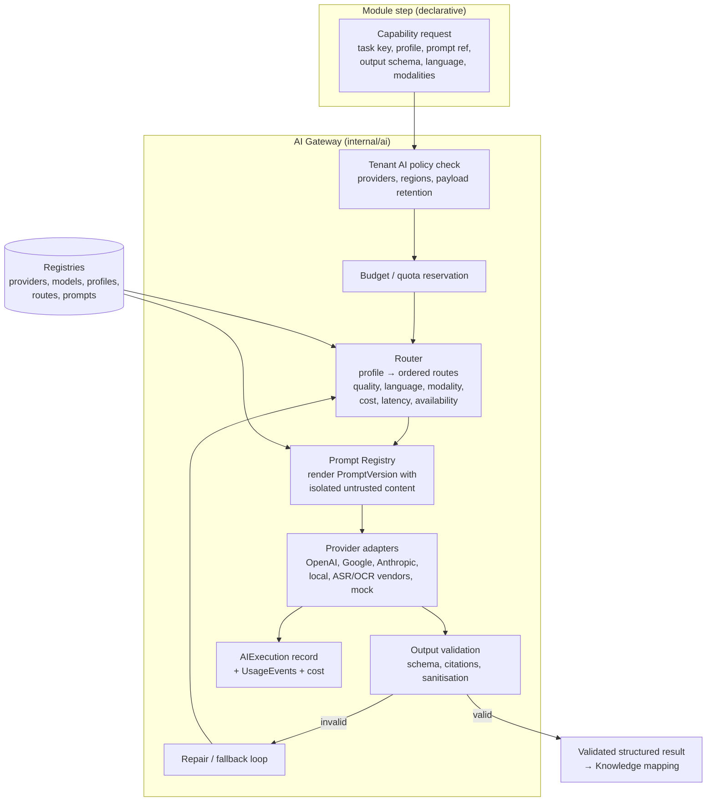

# AI Architecture

| Field | Value |
|---|---|
| Status | Accepted |
| Spec class | Implementation-ready |
| Version | 1.0.0 |
| Last Updated | 2026-09-28 |
| Owner | AI Engineer + Tech Lead |
| Blueprint | BP §11, §14.3, §16, G8 |

## Position (BP §11)

Clerk does **not** train a proprietary foundation model initially. The early moat is orchestration, multimodal context fusion, structured schemas, evidence, evaluation and a data flywheel. Fine-tuning only when dataset quality, consent/legal basis and clear economic or quality benefit exist ([fine-tuning-decision-framework](training/fine-tuning-decision-framework.md)).

## Architecture



## Lifecycle of AI Output (BP §14.3, brief §32)

```text
AI execution → structured result → schema validation → Knowledge → validation (evidence, confidence) → Artifact generation → human review if required
```

AI never directly produces trusted final business documents.

## Component Documents

| Topic | Document |
|---|---|
| Gateway | [ai-gateway](ai-gateway.md) |
| Provider port | [provider-contract](provider-contract.md) |
| Registries | [model-registry](model-registry.md), [model-profiles](model-profiles.md), [prompt-registry](prompt-registry.md), [prompt-versioning](prompt-versioning.md) |
| Routing & fallback | [model-routing](model-routing.md), [fallback-strategy](fallback-strategy.md) |
| Output | [structured-output](structured-output.md), [schema-validation](schema-validation.md), [hallucination-controls](hallucination-controls.md), [confidence-strategy](confidence-strategy.md) |
| Multimodal | [multimodal-processing](multimodal-processing.md) |
| Records & cost | [ai-execution-model](ai-execution-model.md), [token-cost-tracking](token-cost-tracking.md) |
| Observability | [ai-observability](ai-observability.md) |
| Evaluation | [evaluation/](evaluation/evaluation-strategy.md) |
| Training | [training/](training/training-strategy.md) |
| Governance | [governance-ai/](../governance-ai/ai-governance.md) |
| Security | [ai-security](../security/ai-security.md), [prompt-injection](../security/prompt-injection.md) |

## G8 Exit Criterion

Provider swap behind a profile requires no Module change (BP §24).
