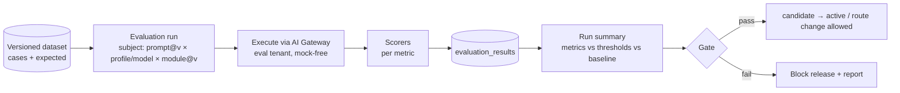

# Evaluation Strategy

| Field | Value |
|---|---|
| Status | Accepted |
| Spec class | Implementation-ready (tooling Open) |
| Version | 1.0.0 |
| Last Updated | 2026-09-28 |
| Owner | AI Engineer |
| Blueprint | BP §11.4, §16.1, §19, App. D, G8 |

## Principles

1. **No vague metrics.** "Looks good" is not an evaluation. Every module has quantitative metrics with thresholds.
2. **Scenario-representative data** over generic benchmarks (BP App. D) — Persian, mixed-language, poor audio, real handwriting.
3. **Every model, prompt, schema or profile route change** runs against a versioned dataset before rollout (BP §11.4).
4. **Quality regression and cost regression both block releases** (BP §16.1).
5. **Numbers in App. D are initial baselines** and must be recalibrated once a representative Persian dataset exists.

## Evaluation Types (BP §11.4)

| Type | Metrics |
|---|---|
| Extraction | Precision/recall/F1 for Action, Owner, Deadline, Decision, Observation … |
| Grounding | Evidence coverage, citation accuracy |
| Hallucination | Unsupported-claims rate |
| Transcription | WER/CER (Persian focus, proper nouns) |
| Vision/OCR | Field accuracy, bounding-box IoU |
| Artifact | Schema validity, completeness, human edit distance |
| Business | Time saved, approval rate, cost per accepted artifact |
| Calibration | ECE, reliability per band |
| Cost/latency | Cost per case, p95 latency |

## Pipeline

## Where Evaluations Run

| Trigger | Suite | Blocking |
|---|---|---|
| PR changing prompts/schemas/module AI config | Smoke subset (fast, ~20 cases/module) | Yes |
| Nightly | Full suites all modules | Alerts |
| Release candidate / model route change | Full suites for affected modules + cost | Yes |
| Canary in production | Online metrics (schema validity, correction rate) | Rollback trigger |

Tooling: [OD-033](../../governance/open-decisions.md#od-033). Results always land in `evaluation_*` tables.

## Related

[evaluation-datasets](evaluation-datasets.md), [evaluation-metrics](evaluation-metrics.md), [golden-datasets](golden-datasets.md), [regression-gates](regression-gates.md), [human-evaluation](human-evaluation.md), [module-evaluations](module-evaluations.md)
