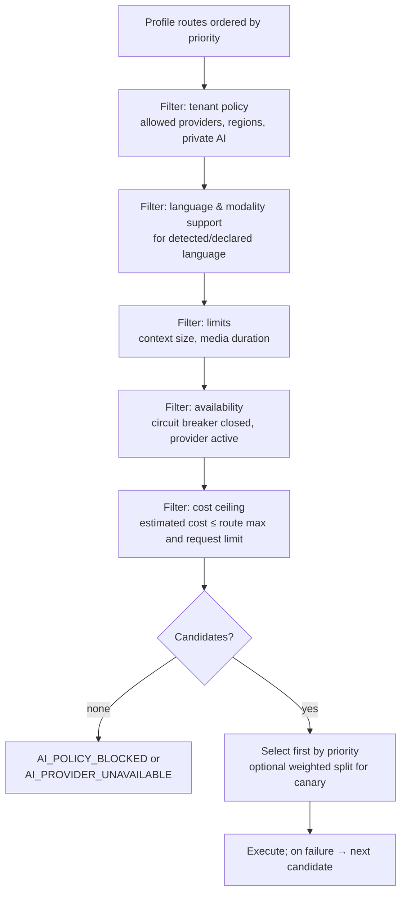

# Model Routing

| Field | Value |
|---|---|
| Status | Accepted |
| Spec class | Implementation-ready |
| Version | 1.0.0 |
| Last Updated | 2026-09-28 |
| Owner | AI domain |
| Blueprint | BP §11.1 (Quality, Language, Modality, Cost, Latency, Availability, Tenant Policy), §22.1 ("Model routing with a cost ceiling") |

## Algorithm

## Details

- **Language:** declared job language, detected source language, or per-chunk language; mixed-language requests prefer routes evaluated for code-switching.
- **Cost estimation:** tokens estimated from chunk token counts + prompt size; audio from duration; images/pages from counts; uses registry pricing.
- **Canary:** a route may carry `traffic_weight` (for example 5%) behind a feature flag during model changes ([model-change-management](../governance-ai/model-change-management.md)); sticky by `job_id` so one job uses one model per task.
- **Latency:** routes have timeouts; latency SLO breaches feed circuit breakers (not synchronous re-ranking in v1).
- **Regional constraints:** `organizations.data_region` + policy restrict routes (architecture-ready, [OD-028](../governance/open-decisions.md#od-028)).
- **Determinism:** routing decision recorded on AIExecution (`routing_decision` with filtered-out reasons) for audit and debugging.
