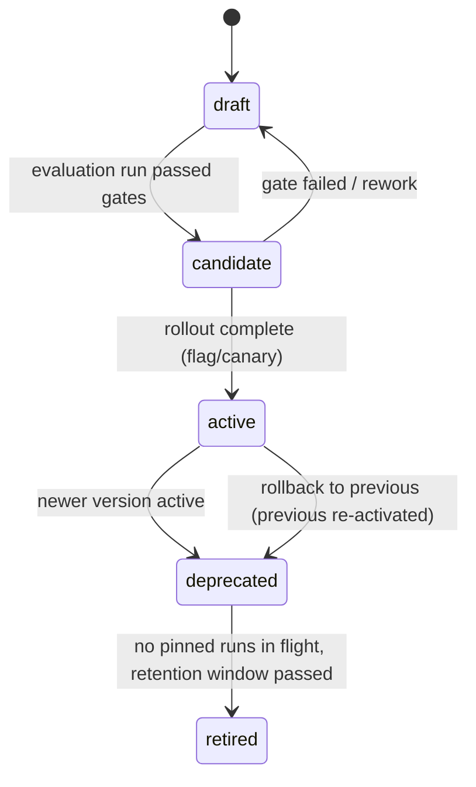

# Prompt Versioning

| Field | Value |
|---|---|
| Status | Accepted |
| Spec class | Implementation-ready |
| Version | 1.0.0 |
| Last Updated | 2026-09-28 |
| Owner | AI domain |
| Blueprint | BP §11.4 ("Every Model, Prompt, or Schema change is run against a versioned dataset before rollout"), §16.1 |

## SemVer Semantics for Prompts

| Change | Bump |
|---|---|
| Output schema breaking change (field removed/renamed/type changed) | MAJOR (module artifact mapping must update) |
| New optional output field; instruction changes that alter behaviour | MINOR |
| Wording fixes without intended behaviour change | PATCH (still evaluated) |

## Resolution

Manifest references ranges (`meeting.action-extraction@^1.0.0`). At job submit the resolved **exact** version per task is pinned on the ProcessingRun (so retries use the same prompt). Active version per key per range is selected by status `active` (one active per MAJOR line).

## Lifecycle

Rollback = re-activate the previous version (immutable, still present). Rollback path is tested (BP §16.1).
