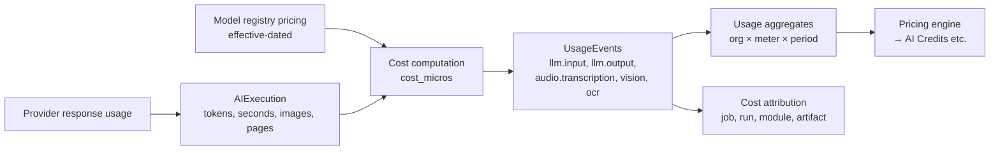

# Token and Cost Tracking

| Field | Value |
|---|---|
| Status | Accepted |
| Spec class | Implementation-ready |
| Version | 1.0.0 |
| Last Updated | 2026-09-28 |
| Owner | AI domain + Commerce |
| Blueprint | BP §5 ("backend records real token, audio, vision, storage, and compute usage"), §5.4, §22 |

## Flow

## Rules

- Provider-reported usage is authoritative; when absent, estimates are recorded with `estimated=true`.
- Cost computed at execution time using effective pricing; never recomputed silently (corrections are compensating usage events).
- Tokens are internal units; customers see AI Credits/minutes/pages ([ai-credit-model](../billing/ai-credit-model.md)).
- Failed attempts' costs are recorded (they were spent) and included in cost-per-job, but customer billing policy for failed attempts is a pricing decision (default: platform absorbs cost of platform-caused failures, [billing-failure-cases](../billing/billing-failure-cases.md)).
