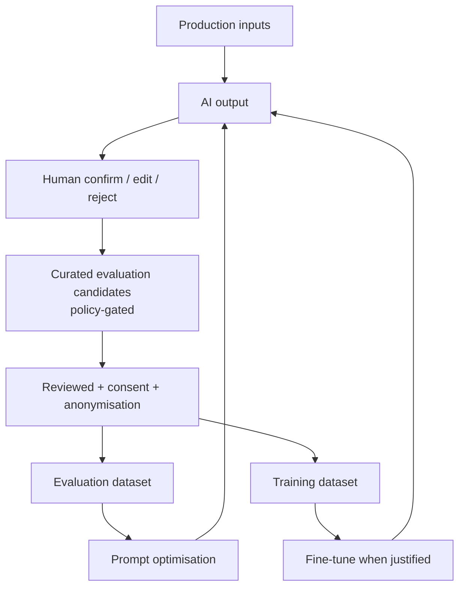

# Model Improvement Flywheel

| Field | Value |
|---|---|
| Status | Accepted |
| Spec class | Baseline |
| Version | 1.0.0 |
| Last Updated | 2026-09-28 |
| Owner | AI Engineer |
| Blueprint | BP §11.3 (AI Dataset Flywheel) |

## Flywheel (BP §11.3)

## Operating Cadence

| Cadence | Activity |
|---|---|
| Weekly | Review correction-rate dashboards per module/prompt version; triage top failure categories |
| Per release | Add new failure cases to golden/regression sets (from staged data or consented candidates) |
| Monthly | Human evaluation sample; calibration update proposals |
| Quarterly | Fine-tuning criteria review ([fine-tuning-decision-framework](fine-tuning-decision-framework.md)) |

## Success Signals

Human Correction Rate trending down; Artifact Acceptance Rate up; Evidence Coverage stable/up; cost per accepted artifact down ([product-kpis](../../product/product-kpis.md)).
