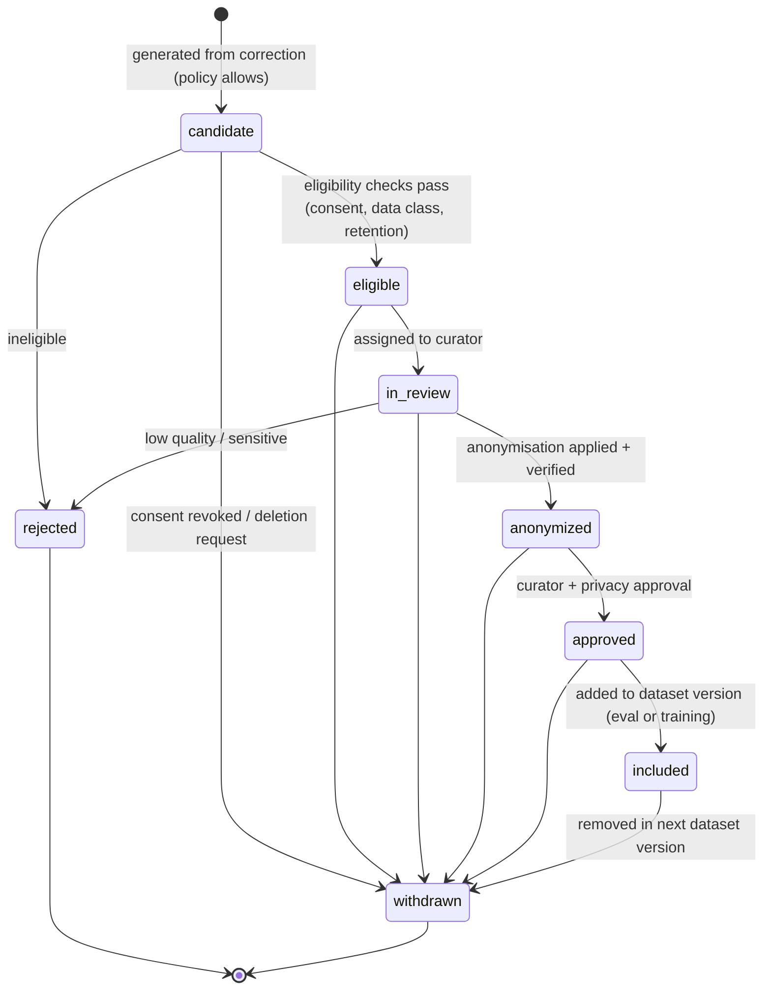

# Training Example Lifecycle

| Field | Value |
|---|---|
| Status | Accepted |
| Spec class | Implementation-ready |
| Version | 1.0.0 |
| Last Updated | 2026-09-28 |
| Owner | AI Engineer + Privacy |
| Blueprint | BP §11.3 ("Reviewed + Consent + Anonymization"), App. E (029 training) |

## States

## Eligibility Checks

Consent type covers intended use; source data classification ≠ Restricted unless contract allows; source not under deletion request; retention permits; module and language tags present.

## Versioning

Datasets referencing examples are versioned (`dataset@version`); inclusion/withdrawal changes produce new versions; each version records its example IDs and consent basis snapshot.

## Access

Curators are platform staff with dedicated role; access through audited tooling; examples never exported outside controlled storage except to approved fine-tuning providers under no-reuse terms.
