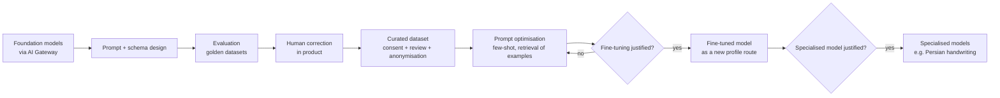

# Training Strategy

| Field | Value |
|---|---|
| Status | Accepted |
| Spec class | Baseline |
| Version | 1.0.0 |
| Last Updated | 2026-09-28 |
| Owner | AI Engineer + Privacy |
| Blueprint | BP §11, §11.3, §11.5, §15 |

## Position

Clerk collects the **infrastructure** for future model improvement but does **not** assume immediate foundation-model training (BP §11).

## Progression

## Rules

- Customer content is **not** used for general model training by default (BP §11.3, §15).
- Human corrections do not automatically become training data ([correction-data](correction-data.md)).
- A training example requires consent/legal basis, eligibility, review, anonymisation where needed, approval and versioning ([training-example-lifecycle](training-example-lifecycle.md)).
- Fine-tuned models enter production only as profile routes passing the same evaluation gates ([fine-tuning-decision-framework](fine-tuning-decision-framework.md)).
- Training data is never sent to a provider whose terms allow them to reuse it beyond the fine-tuning job.
