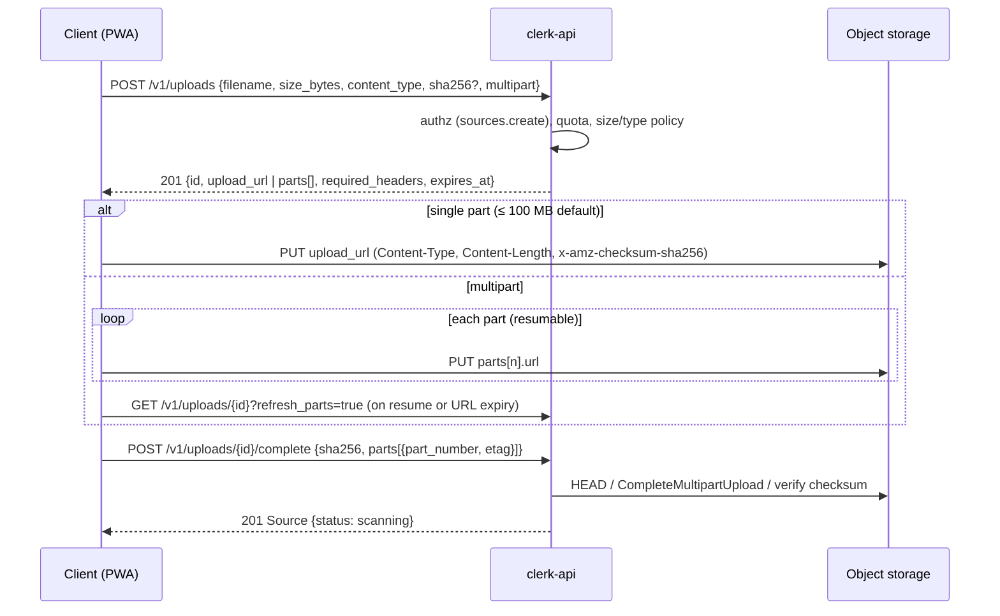

# Uploads API

| Field | Value |
|---|---|
| Status | Accepted |
| Spec class | Implementation-ready |
| Version | 1.0.0 |
| Last Updated | 2026-09-28 |
| Owner | Sources domain |
| Blueprint | BP §8, §9.1, §14.2, App. B |

## Purpose

HTTP contract for direct-to-storage uploads. Architecture and state machine: [ingestion/upload-flow](../ingestion/upload-flow.md). Decision: [ADR-005](../governance/adr/ADR-005-direct-object-storage-upload.md).

## Sequence

## Rules

| Rule | Value (provisional) |
|---|---|
| Single-part max | 100 MB |
| Multipart part size | 8–64 MB (client chooses; min 5 MB per S3 rules) |
| Absolute max per file | Plan/module limit (for example 2 GB video) |
| Presigned PUT TTL | 15 min; refresh via `GET /v1/uploads/{id}?refresh_parts=true` |
| Session expiry | 24 h from creation (resumable within) |
| Allowed types | Union of accepted kinds of installed modules + generic Inbox policy ([mime-validation](../ingestion/mime-validation.md)) |
| Checksum | SHA-256 required at completion; verified server-side |
| Idempotency | Required on create and complete |

Small text notes use `POST /v1/sources` (JSON, ≤ 200,000 characters) instead of an upload session.

## Offline Integration

`client_ref` (offline temporary ID) is echoed back on the session and Source so the PWA can reconcile local records ([synchronization](../pwa/synchronization.md)). Optional `job_id` + `job_slot` attach the resulting Source to a Draft Job at completion (no submission).
