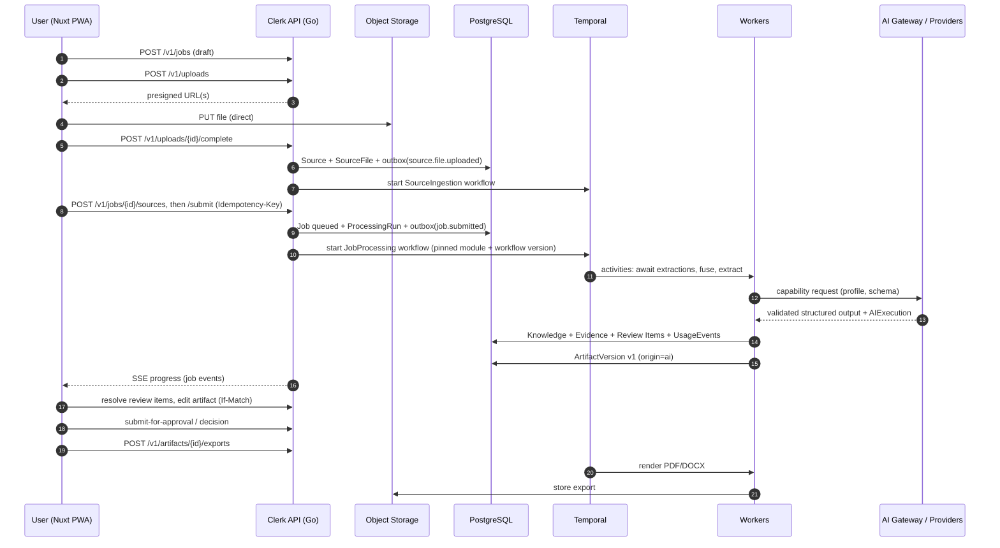

# Architecture Overview

| Field | Value |
|---|---|
| Status | Accepted |
| Spec class | Baseline |
| Version | 1.0.0 |
| Last Updated | 2026-09-28 |
| Owner | Technical Leadership |
| Blueprint | BP §0, §6, §7, §8 |

## Purpose

Single entry point to the architecture. Summarises the decisions and links to the owning documents. Read this first, then [system-context](system-context.md) → [container-architecture](container-architecture.md) → [bounded-contexts](bounded-contexts.md).

## Architecture in Ten Statements

1. **Go Modular Monolith** with explicit bounded contexts; API and workers are separate processes sharing one codebase ([ADR-001](../governance/adr/ADR-001-backend-go.md), [ADR-002](../governance/adr/ADR-002-modular-monolith.md)).
2. **Nuxt 4 PWA** talks to a versioned **REST + OpenAPI** API through a generated Web SDK ([ADR-004](../governance/adr/ADR-004-rest-openapi.md), [ADR-022](../governance/adr/ADR-022-nuxt-pwa-frontend.md)).
3. **PostgreSQL** is the system of record; **pgvector** for early embeddings; **Redis** only for ephemeral state; **S3-compatible storage** for binaries ([ADR-006](../governance/adr/ADR-006-postgresql-primary-store.md), [ADR-019](../governance/adr/ADR-019-pgvector-initial.md), [ADR-020](../governance/adr/ADR-020-redis-ephemeral-state.md), [ADR-015](../governance/adr/ADR-015-s3-compatible-storage.md)).
4. **Temporal** orchestrates all long-running work; activities persist business state to PostgreSQL ([ADR-003](../governance/adr/ADR-003-temporal-workflows.md)).
5. **Transactional Outbox + EventBus port** propagates domain facts ([ADR-007](../governance/adr/ADR-007-event-architecture.md)).
6. **Uploads go directly to object storage** via presigned URLs ([ADR-005](../governance/adr/ADR-005-direct-object-storage-upload.md)).
7. **Modules are declarative-first packages** interpreted by generic platform workflows; no third-party code in-process ([ADR-008](../governance/adr/ADR-008-declarative-first-modules.md)).
8. **AI is provider-neutral**: modules request capability profiles from the AI Gateway; outputs are schema-validated and become Knowledge with Evidence ([ADR-017](../governance/adr/ADR-017-provider-neutral-ai.md), [ADR-010](../governance/adr/ADR-010-structured-ai-output.md), [ADR-011](../governance/adr/ADR-011-evidence-first.md)).
9. **Artifacts are versioned structured JSON**, rendered to Web/PDF/DOCX via templates ([ADR-016](../governance/adr/ADR-016-structured-artifact-content.md)).
10. **Multi-tenant from day one**: application tenant guard + PostgreSQL RLS; tenant context everywhere ([ADR-013](../governance/adr/ADR-013-multi-tenant-isolation.md)).

## End-to-End Flow

## Where to Go Next

| Topic | Document |
|---|---|
| External actors and systems | [system-context](system-context.md) |
| Deployable units | [container-architecture](container-architecture.md) |
| Go packages and components | [component-architecture](component-architecture.md) |
| Domains and ownership | [domain-architecture](domain-architecture.md), [bounded-contexts](bounded-contexts.md), [dependency-rules](dependency-rules.md) |
| Runtime and deployment | [runtime-architecture](runtime-architecture.md), [deployment-architecture](deployment-architecture.md) |
| Flows | [data-flow-architecture](data-flow-architecture.md), [request-lifecycle](request-lifecycle.md), [job-lifecycle](job-lifecycle.md), [source-lifecycle](source-lifecycle.md), [artifact-lifecycle](artifact-lifecycle.md) |
| Coordination | [workflow-architecture](workflow-architecture.md), [event-architecture](event-architecture.md) |
| Reliability | [concurrency-strategy](concurrency-strategy.md), [failure-model](failure-model.md), [idempotency-strategy](idempotency-strategy.md) |
| Tenancy | [tenancy-architecture](tenancy-architecture.md) |
| Evolution | [future-service-extraction](future-service-extraction.md) |
