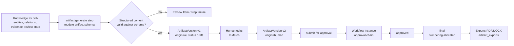

# Artifact Lifecycle (Architecture View)

| Field | Value |
|---|---|
| Status | Accepted |
| Spec class | Baseline |
| Version | 1.0.0 |
| Last Updated | 2026-09-28 |
| Owner | Artifacts domain |
| Blueprint | BP §12, §12.1 |

## Purpose

How Artifacts are generated, edited, approved, finalised and exported, and how that spans contexts. Canonical status machine: [approval-lifecycle](../artifacts/approval-lifecycle.md). Versioning rules: [artifact-versioning](../artifacts/artifact-versioning.md).

## Artifact Generation

## Rules

1. Artifacts are generated from Knowledge, never directly from raw model text ([ADR-010](../governance/adr/ADR-010-structured-ai-output.md)).
2. Each edit creates an immutable ArtifactVersion with `origin ∈ {ai, human, system}` and `parent_version_id`.
3. Approval targets a specific version; while in review the artifact is locked by default (workflow may opt into `supersede`, where an edit supersedes pending approval requests).
4. Final status requires the configured approval conditions (BP §12); numbering is allocated transactionally at finalisation.
5. Exports reference `(artifact_version_id, template_version_id, brand_kit_version)`; the same inputs yield byte-comparable output within renderer determinism limits.
6. "Exported" is a derived indicator (≥1 completed export), not a status ([source-of-truth-policy](../governance/source-of-truth-policy.md)).

## Knowledge ↔ Artifact Edits

Human edits to an Artifact field that is bound to a Knowledge item offer "apply to Knowledge" (creating a `human_modified` correction). Default for v1: field bound edits update Knowledge as a correction; free-text edits do not. Detail: [editor-contract](../artifacts/editor-contract.md).

## Related Documents

[artifact-domain](../artifacts/artifact-domain.md), [approval](../platform/collaboration/approval.md), [rendering](../artifacts/rendering.md)
