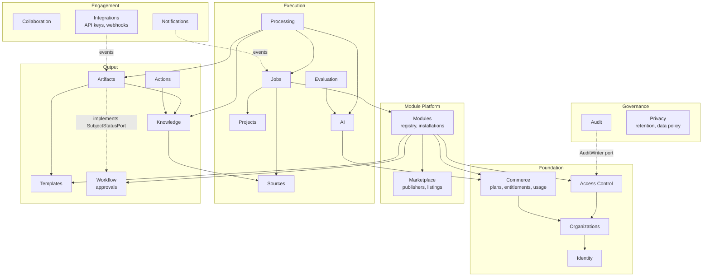

# Bounded Contexts

| Field | Value |
|---|---|
| Status | Accepted |
| Spec class | Implementation-ready |
| Version | 1.0.0 |
| Last Updated | 2026-09-28 |
| Owner | Technical Leadership |
| Blueprint | BP §7, §7.3, App. E |

## Purpose

Canonical list of bounded contexts with ownership, public interfaces, allowed and forbidden dependencies, events, and persistence ownership. BP §7 defines 19 contexts; this document maps them to Go packages (see [component-architecture](component-architecture.md)).

## Context Map

Arrows mean "depends on the public facade of". Dotted arrows are event-driven or port-driven couplings (the consumer does not call the producer). Every context also depends on Access (authorization) and Organizations (tenant) facades; those edges are omitted for readability.

## Context Catalogue

Legend: **Facade** = public Go API in `internal/<ctx>/api.go`; **Owns** = tables it alone reads and writes.

### Identity (`internal/identity`)
- **Responsibility:** users, auth identities, sessions, MFA factors, authentication flows.
- **Facade:** `Users.Get`, `Sessions.Validate`, `Authenticator`.
- **Allowed deps:** platform kernel only. **Forbidden:** Organizations, Commerce (identity is tenant-independent).
- **Produces:** `identity.user.created`, `identity.session.created`, `identity.session.revoked`, `identity.mfa.enrolled`.
- **Consumes:** none.
- **Owns:** `users`, `auth_identities`, `sessions`, `mfa_factors`, `magic_link_tokens`.

### Organizations (`internal/organization`)
- **Responsibility:** Organization (tenant), membership, invitations, teams, personal workspaces, tenant context resolution.
- **Facade:** `Tenants.Resolve(principal, orgID) → tenant.Context`, `Memberships.Get`, `Teams.MembersOf`.
- **Allowed deps:** Identity. **Forbidden:** Commerce (subscriptions subscribe to org events instead).
- **Produces:** `organization.created`, `organization.member.invited`, `organization.member.joined`, `organization.member.removed`, `organization.team.changed`.
- **Owns:** `organizations`, `memberships`, `invitations`, `teams`, `team_members`.

### Access Control (`internal/access`)
- **Responsibility:** roles, permissions catalogue (incl. module-registered), role assignments, resource policies, permission evaluation.
- **Facade:** `Authorizer.Check(tc, permission, resource)`, `PermissionCatalog.Register(namespace, perms)`.
- **Allowed deps:** Organizations, Identity. **Forbidden:** Commerce (entitlements are composed in `platform/authz`, not inside access).
- **Produces:** `access.role.created`, `access.role.changed`, `access.assignment.changed`.
- **Owns:** `roles`, `permissions`, `role_permissions`, `membership_roles`, `resource_grants`.

### Commerce (`internal/commerce`)
- **Responsibility:** plans, plan versions, subscriptions, seats, entitlement definitions and grants, usage events/aggregates, quotas, pricing engine, payment provider port.
- **Facade:** `Entitlements.Check(tc, key)`, `Quotas.Reserve/Commit`, `UsageRecorder.Record(tx, event)`.
- **Allowed deps:** Organizations. **Forbidden:** Modules (module entitlement keys are opaque strings to Commerce).
- **Produces:** `subscription.changed`, `entitlement.changed`, `usage.recorded`, `quota.threshold.reached`, `quota.exceeded`.
- **Consumes:** `organization.created` (start default plan), `module.installed` (seat/add-on accounting where relevant).
- **Owns:** `plans`, `plan_versions`, `subscriptions`, `entitlement_definitions`, `plan_entitlements`, `organization_entitlements`, `usage_events`, `usage_aggregates`, `quota_counters`, `billing_customers`, `invoices`.

### Marketplace (`internal/marketplace`)
- **Responsibility:** publishers, catalog listings, verification/review status, pricing metadata.
- **Facade:** `Publishers.Get`, `Listings.ForModule`.
- **Allowed deps:** platform kernel. **Owns:** `publishers`, `catalog_listings`, `listing_reviews`.

### Module Platform (`internal/module`)
- **Responsibility:** module registry, manifest validation, versions, dependencies, installations, assignments, configuration, lifecycle.
- **Facade:** `Registry.ResolveForJob(tc, moduleKey) → PinnedModule`, `Installations.IsEnabled`.
- **Allowed deps:** Marketplace, Commerce (entitlement checks), Access (permission registration), Template (template registration), Workflow (workflow definition registration).
- **Forbidden:** Jobs, Sources, Knowledge, Artifacts (modules are upstream of execution).
- **Produces:** `module.version.published`, `module.installed`, `module.enabled`, `module.disabled`, `module.upgraded`, `module.suspended`, `module.uninstalled`, `module.configuration.changed`.
- **Owns:** `modules`, `module_versions`, `module_dependencies`, `module_installations`, `module_assignments`, `module_configurations`.

### Projects (`internal/project`)
- **Responsibility:** optional project context and project membership scope.
- **Owns:** `projects`, `project_members`. **Produces:** `project.created`, `project.member.changed`.

### Sources (`internal/source`)
- **Responsibility:** upload sessions, sources, source files (originals + renditions), scanning, extraction pipelines per source type, normalised content, chunks, embeddings, deduplication, extraction cache.
- **Facade:** `Sources.Get`, `Sources.AwaitExtractions(tc, sourceIDs, requiredKinds)`, `Chunks.Read`.
- **Allowed deps:** AI (for transcription/OCR/vision capabilities via gateway), Commerce (usage), platform BlobStore. **Forbidden:** Jobs, Modules (ingestion is source-type-driven, never module-driven).
- **Produces:** `source.upload.created`, `source.file.uploaded`, `source.scan.completed`, `source.quarantined`, `source.processing.completed`, `source.processing.failed`, `source.deleted`.
- **Owns:** `upload_sessions`, `sources`, `source_files`, `source_extractions`, `source_chunks`, `chunk_embeddings`.

### Jobs (`internal/job`)
- **Responsibility:** Job aggregate, state machine, source attachment, pinning, user-visible status.
- **Facade:** `Jobs.Get`, `Jobs.Transition` (for processing context).
- **Allowed deps:** Modules, Sources, Projects, Commerce. **Forbidden:** AI, Knowledge internals.
- **Produces:** `job.created`, `job.submitted`, `job.processing.started`, `job.review.required`, `job.processing.completed`, `job.failed`, `job.cancelled`.
- **Owns:** `jobs`, `job_sources`.

### Processing (`internal/processing`)
- **Responsibility:** ProcessingRun/Step records, module pipeline interpreter (declarative workflow executor), step registry (platform + official native steps).
- **Allowed deps:** Jobs, Modules, Sources, AI, Knowledge, Artifacts, Workflow, Commerce.
- **Produces:** `processing.run.started`, `processing.step.completed`, `processing.run.completed`, `processing.run.failed`.
- **Owns:** `processing_runs`, `processing_steps`.

### AI (`internal/ai`)
- **Responsibility:** provider registry, model registry, model profiles, prompt registry, routing, fallback, output validation, AIExecution records, provider adapters.
- **Facade:** `Gateway.Execute(ctx, tc, CapabilityRequest) → Result`.
- **Allowed deps:** Commerce (usage, budgets), Privacy (tenant AI policy). **Forbidden:** Knowledge, Artifacts, Modules (gateway is domain-agnostic).
- **Produces:** `ai.execution.completed`, `ai.execution.failed`, `ai.provider.degraded`.
- **Owns:** `ai_providers`, `ai_models`, `model_profiles`, `model_profile_routes`, `prompts`, `prompt_versions`, `ai_executions`.

### Evaluation (`internal/evaluation`)
- **Responsibility:** evaluation datasets, cases, runs, results, regression gates, training-example curation.
- **Allowed deps:** AI, Knowledge (read, for candidate generation via facade), Privacy (consent).
- **Owns:** `evaluation_datasets`, `evaluation_cases`, `evaluation_runs`, `evaluation_results`, `training_examples`.

### Knowledge (`internal/knowledge`)
- **Responsibility:** entities, relations, evidence links, review items, corrections, context fusion, retrieval.
- **Facade:** `Knowledge.ForJob`, `Evidence.For(target)`, `Review.Resolve`.
- **Allowed deps:** Sources (chunk references), AI (retrieval embeddings via gateway).
- **Forbidden:** Artifacts (Artifacts depend on Knowledge, never the reverse).
- **Produces:** `knowledge.extracted`, `knowledge.review.required`, `knowledge.item.confirmed`, `knowledge.item.modified`, `knowledge.item.rejected`.
- **Owns:** `knowledge_entities`, `knowledge_relations`, `evidence_links`, `review_items`.

### Artifacts (`internal/artifact`)
- **Responsibility:** Artifact, ArtifactVersion, structured content validation, exports.
- **Allowed deps:** Knowledge, Templates, Modules (artifact schemas), Commerce.
- **Produces:** `artifact.generated`, `artifact.version.created`, `artifact.submitted`, `artifact.approved`, `artifact.finalized`, `artifact.export.completed`, `artifact.export.failed`.
- **Owns:** `artifacts`, `artifact_versions`, `artifact_exports`.

### Templates (`internal/template`)
- **Responsibility:** brand kits, templates, template versions, numbering sequences, renderer selection.
- **Owns:** `brand_kits`, `templates`, `template_versions`, `numbering_sequences`.
- **Produces:** `template.published`, `brand_kit.changed`.

### Workflow (`internal/workflow`)
- **Responsibility:** business workflow definitions/versions/instances, approval requests/decisions, sign-off. Subject-agnostic: an approval targets a `(subject_type, subject_id, subject_version_id)`.
- **Allowed deps:** Access, Organizations. Artifact status changes happen through `SubjectStatusPort`, implemented by Artifacts and injected at the composition root ([dependency-rules](dependency-rules.md)).
- **Produces:** `workflow.instance.started`, `approval.requested`, `approval.decided`, `workflow.instance.completed`.
- **Owns:** `workflow_definitions`, `workflow_versions`, `workflow_instances`, `approval_requests`, `approval_decisions`.

### Actions (`internal/action`)
- **Responsibility:** action items (owner, deadline, status, source artifact/knowledge link), overdue detection.
- **Allowed deps:** Knowledge, Projects. Artifacts are referenced by ID only.
- **Produces:** `action.created`, `action.updated`, `action.overdue`, `action.resolved`.
- **Owns:** `action_items`, `action_item_assignments`.

### Collaboration (`internal/collaboration`)
- **Owns:** `comments`, `mentions`, `shares`. **Produces:** `comment.created`, `share.created`.

### Notifications (`internal/notification`)
- **Responsibility:** in-app and email notifications from events; preferences.
- **Allowed deps:** none synchronous; consumes events. **Owns:** `notifications`, `notification_preferences`.

### Integrations (`internal/integration`)
- **Responsibility:** API keys, webhook endpoints, deliveries, signing.
- **Owns:** `api_keys`, `webhook_endpoints`, `webhook_deliveries`.
- **Consumes:** subscribed public events. **Produces:** `webhook.delivery.failed`.

### Audit (`internal/audit`)
- **Responsibility:** append-only audit events (written in-transaction via `AuditWriter` port), query, export.
- **Owns:** `audit_events`. **Allowed deps:** none (sink).

### Privacy (`internal/privacy`)
- **Responsibility:** retention policies, data usage/training policies, consent records, export/deletion requests and sweeps, vendor registry.
- **Owns:** `retention_policies`, `data_usage_policies`, `consent_records`, `data_export_requests`, `data_deletion_requests`, `vendor_registry`.
- **Produces:** `privacy.deletion.requested`, `privacy.deletion.completed`, `privacy.policy.changed`.

## Mapping to Blueprint §7

| BP §7 context | Package(s) |
|---|---|
| Identity | identity |
| Organizations | organization |
| Access | access |
| Commerce | commerce |
| Modules | module (+ marketplace for publishers) |
| Projects | project |
| Sources | source |
| Jobs | job |
| Processing | processing |
| AI | ai, evaluation |
| Knowledge | knowledge |
| Artifacts | artifact |
| Templates | template |
| Workflow | workflow |
| Actions | action |
| Collaboration | collaboration |
| Platform (Notification, Integration, Webhook) | notification, integration |
| Governance (Audit, Retention, Data Policy) | audit, privacy |
| Marketplace | marketplace |

## Related Documents

[dependency-rules](dependency-rules.md), [entity-catalog](../data/entity-catalog.md), [event-architecture](event-architecture.md)
