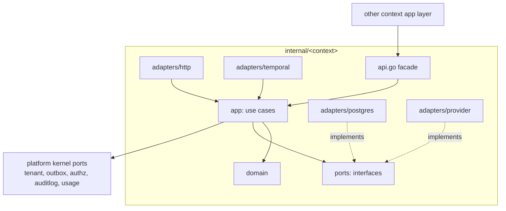

# Component Architecture (Go Backend)

| Field | Value |
|---|---|
| Status | Accepted |
| Spec class | Implementation-ready |
| Version | 1.0.0 |
| Last Updated | 2026-09-28 |
| Owner | Tech Lead (Go) |
| Blueprint | BP §6, §6.1, §7 |

## Purpose

Defines the intended Go package structure, layering inside each bounded context, dependency inversion rules, and how HTTP, SQL and Temporal adapters stay outside domain logic. Tooling decisions: router `go-chi/chi v5` confined to `adapters/http` ([ADR-023](../governance/adr/ADR-023-http-router-chi.md)); `sqlc + pgx/v5` confined to `adapters/postgres`, with generated types never used as domain entities ([ADR-024](../governance/adr/ADR-024-sql-access-sqlc-pgx.md)); `goose v3` migrations ([ADR-025](../governance/adr/ADR-025-migrations-goose.md)); Go 1.27.x ([ADR-027](../governance/adr/ADR-027-go-runtime-baseline.md)).

## 1. Top-Level Layout

```text
internal/
  platform/            # shared kernel: technical only, no business rules
    tenant/            # TenantContext type, context helpers
    ids/               # UUIDv7 generation, typed IDs
    clock/             # Clock interface (testable time)
    errors/            # domain error types → API error codes mapping
    db/                # Tx manager, RLS session setup (SET LOCAL app.org_id)
    outbox/            # Outbox writer port + envelope
    eventbus/          # EventBus port, consumer registry, inbox dedup
    idempotency/       # idempotency-key store port
    blob/              # BlobStore port (S3-compatible)
    authz/             # Guard port composing Entitlement + Permission + Policy
    auditlog/          # AuditWriter port (implemented by internal/audit)
    usage/             # UsageRecorder port (implemented by internal/commerce)
    telemetry/         # OTel helpers, log field conventions
    featureflag/       # flag evaluation port (OpenFeature-compatible)
  identity/
  organization/
  access/
  commerce/            # plans, subscriptions, entitlements, usage, billing
  marketplace/         # publishers, listings
  module/              # registry, versions, installations, configuration
  project/
  source/              # uploads, sources, files, extractions, chunks, ingestion pipelines
  job/                 # jobs, job_sources, job state machine
  processing/          # processing runs/steps, module pipeline interpreter (Temporal workflows)
  ai/                  # providers, models, profiles, prompts, executions, gateway, router
  evaluation/          # datasets, cases, runs, results, training examples
  knowledge/           # entities, relations, evidence, review items, retrieval
  artifact/            # artifacts, versions, exports
  template/            # brand kits, templates, numbering
  workflow/            # workflow definitions/versions/instances, approvals
  action/              # action items
  collaboration/       # comments, mentions, shares
  notification/        # notifications, email delivery
  integration/         # api keys, webhook endpoints/deliveries
  audit/               # audit events, audit query/export
  privacy/             # retention policies, data usage policies, export/deletion jobs
```

`apps/api/main.go` and `apps/worker/main.go` are the **composition roots**: the only places that construct adapters and wire them into use cases.

## 2. Layering Inside a Bounded Context

```text
internal/<context>/
  api.go               # PUBLIC facade: interfaces + DTOs other contexts may use
  domain/              # entities, value objects, state machines, domain errors, events
  app/                 # use cases (commands/queries); depends on domain + ports
  ports/               # repository and gateway interfaces owned by this context
  adapters/
    postgres/          # SQL repositories (implements ports)
    http/              # HTTP handlers (transport), request/response mapping
    temporal/          # workflows/activities (transport for async use cases)
    <provider>/        # external systems (e.g. s3, ffmpeg, openai)
  events/              # event type constants + payload structs (published schema)
  testdata/
```



Rules:

| Layer | May import | Must not import |
|---|---|---|
| `domain` | stdlib, `platform/ids`, `platform/clock`, `platform/errors` | SQL, HTTP, Temporal, other contexts, `app`, `adapters` |
| `app` | own `domain`, own `ports`, other contexts' `api.go` facades, `platform/*` ports | any `adapters` package, SQL drivers, HTTP types, Temporal SDK (except via a port) |
| `ports` | own `domain` | adapters |
| `adapters/*` | own `app`, `domain`, `ports`; drivers/SDKs | other contexts' internals |
| `api.go` | own `app`/`domain` types re-exported as DTOs | adapters |

## 3. Per-Context Component Specification Template

Each context's specification (in `platform/`, `ingestion/`, `jobs/`, `knowledge/`, `ai/`, `artifacts/`, `billing/` docs) must describe:

| Aspect | Content |
|---|---|
| Domain models | Aggregates, entities, value objects, invariants |
| Use cases | Commands and queries in `app` |
| Repository interfaces | Ports with tenant-aware signatures: `Get(ctx, tc tenant.Context, id JobID)` |
| Transport boundaries | HTTP routes (OpenAPI operationIds), Temporal workflows/activities, event consumers |
| Events | Produced and consumed event types |
| Errors | Domain errors and their API error codes ([error-catalog](../api/error-catalog.md)) |
| Authorization hooks | Which `authz.Guard` checks each use case performs |
| Testing boundaries | Unit (domain), app (fakes for ports), repository (real PostgreSQL + RLS), contract (HTTP/OpenAPI), workflow (Temporal test env) |

## 4. Per-Context Summary

| Context | Key domain models | Key use cases | Repository ports | Transports | Authorization hooks |
|---|---|---|---|---|---|
| identity | User, AuthIdentity, Session, MFAFactor | SignIn, VerifyMagicLink, CompleteOIDC, RotateSession, RevokeSession, EnrollMFA | UserRepo, SessionRepo, IdentityRepo | HTTP `/v1/auth/*`, `/v1/me` | Self only; admin revoke requires `organization.members.manage` |
| organization | Organization, Membership, Invitation, Team | CreateOrganization, Invite, AcceptInvitation, RemoveMember, CreateTeam | OrgRepo, MembershipRepo, TeamRepo | HTTP `/v1/organizations*`, `/v1/teams` | `organization.*` permissions |
| access | Role, Permission, RoleAssignment, Policy | Evaluate, CreateRole, AssignRole, RegisterModulePermissions | RoleRepo, PermissionCatalog | HTTP `/v1/roles`, `/v1/permissions`; facade `Authorizer` | `roles.manage` |
| commerce | Plan, PlanVersion, Subscription, EntitlementDefinition, Grant, UsageEvent, UsageAggregate, Quota | CheckEntitlement, RecordUsage, EvaluateQuota, ChangeSubscription | PlanRepo, SubscriptionRepo, EntitlementRepo, UsageRepo | HTTP `/v1/subscription`, `/v1/usage`; payment webhooks; facade `Entitlements`, `UsageRecorder` | `billing.view`, `billing.manage` |
| marketplace | Publisher, Listing | PublishListing, SuspendListing | PublisherRepo, ListingRepo | facade only in v1 | platform-admin |
| module | Module, ModuleVersion, Manifest, Installation, Assignment, Configuration | ValidateManifest, RegisterVersion, Install, Enable, Disable, Upgrade, Uninstall, Configure, ResolveForJob | ModuleRepo, VersionRepo, InstallationRepo | HTTP `/v1/modules*`, `/v1/store/*`; Temporal `ModuleInstallWorkflow` | `modules.install`, `modules.configure` + entitlement `module.<key>` |
| project | Project, ProjectMember | CreateProject, AddMember | ProjectRepo | HTTP `/v1/projects` | `projects.*` + project scope |
| source | UploadSession, Source, SourceFile, Extraction, Chunk | CreateUploadSession, CompleteUpload, RegisterTextSource, RunIngestion, DeleteSource | UploadRepo, SourceRepo, ExtractionRepo, ChunkRepo; BlobStore; Scanner | HTTP `/v1/uploads*`, `/v1/sources*`; Temporal `SourceIngestionWorkflow` | `sources.*` + resource ownership |
| job | Job, JobSource, JobStateMachine | CreateDraft, AttachSource, DetachSource, Submit, Cancel, Retry | JobRepo | HTTP `/v1/jobs*`, SSE | `jobs.create` + `<module>.create` + entitlement |
| processing | ProcessingRun, ProcessingStep, PipelinePlan | StartRun, RecordStep, CompleteRun | RunRepo, StepRepo | Temporal `JobProcessingWorkflow` + step activities | system (tenant context from job) |
| ai | Provider, Model, ModelProfile, Prompt, PromptVersion, AIExecution, RoutingDecision | Execute(capability request), Route, ValidateOutput | RegistryRepo, ExecutionRepo; Provider port | Temporal activities; admin HTTP (later) | tenant AI policy |
| evaluation | Dataset, Case, Run, Result, TrainingExample | RunEvaluation, PromoteCandidate, CurateTrainingExample | EvalRepo | CLI/CI, Temporal | platform-admin; consent checks |
| knowledge | Entity, Relation, EvidenceLink, ReviewItem | UpsertFromExtraction, Fuse, ResolveReviewItem, Retrieve | EntityRepo, RelationRepo, EvidenceRepo, ReviewRepo, VectorIndex | HTTP `/v1/jobs/{id}/review-items`, `/v1/review-items/*`; activities | `<module>.edit`/`jobs.review` |
| artifact | Artifact, ArtifactVersion, ArtifactExport | Generate, Edit (If-Match), ListVersions, Export | ArtifactRepo, VersionRepo, ExportRepo | HTTP `/v1/artifacts*`; Temporal `ExportWorkflow` | `artifacts.edit`, `artifacts.export` + entitlement `export.<fmt>` |
| template | BrandKit, Template, TemplateVersion, NumberingSequence | PublishTemplate, UpdateBrandKit, NextNumber | TemplateRepo, NumberingRepo | HTTP `/v1/templates`, `/v1/brand-kit` | `templates.manage` + entitlement |
| workflow | WorkflowDefinition, WorkflowVersion, WorkflowInstance, ApprovalRequest, ApprovalDecision | StartApproval, Decide, Escalate | WorkflowRepo, ApprovalRepo | HTTP `/v1/artifacts/{id}/submit-for-approval`, `/v1/approvals/*`; Temporal `ApprovalWorkflow` | `artifacts.approve` / module approve + policy |
| action | ActionItem | CreateFromKnowledge, Update, MarkOverdue | ActionRepo | HTTP `/v1/actions*`; scheduled activity | `actions.*` + scope |
| collaboration | Comment, Mention, Share | Comment, Share | CommentRepo, ShareRepo | HTTP (future endpoints) | resource policy |
| notification | Notification, Preference | Notify | NotificationRepo; Mailer port | event consumers | recipient scope |
| integration | ApiKey, WebhookEndpoint, WebhookDelivery | CreateKey, RevokeKey, RegisterEndpoint, Deliver | KeyRepo, WebhookRepo | HTTP `/v1/api-keys`, `/v1/webhooks`; consumer + delivery worker | `integrations.manage` + entitlement `api.access` |
| audit | AuditEvent | Record (in-tx), Query, Export | AuditRepo | facade `AuditWriter`; HTTP `/v1/audit` | `audit.view` + entitlement `audit.log` |
| privacy | RetentionPolicy, DataUsagePolicy, ExportRequest, DeletionRequest | ApplyRetention, RequestExport, RequestDeletion | PolicyRepo, RequestRepo | HTTP (settings), Temporal `RetentionSweepWorkflow` | Owner/Admin |

## 5. Dependency Inversion Expectations

- Use cases receive dependencies through constructors (plain structs, no DI container required).
- Every port that touches tenant data takes `tenant.Context` explicitly — not hidden in `context.Context` only — so the compiler forces callers to supply it. (`context.Context` still carries it for telemetry.)
- Transactions: `app` calls `db.TxManager.WithinTx(ctx, tc, func(tx) error)`. The Tx manager sets `SET LOCAL app.org_id` and actor variables. Repositories accept the transactional handle; the outbox writer and audit writer participate in the same transaction.
- Temporal: workflows live in `adapters/temporal`, call **activities** that invoke `app` use cases. Workflows never call repositories directly.
- HTTP handlers: decode → build command → call use case → map result/error. No business logic.

### Example (interface sketch, illustrative only)

```go
// internal/job/ports/repository.go
type JobRepository interface {
    Get(ctx context.Context, tx db.Tx, tc tenant.Context, id ids.JobID) (*domain.Job, error)
    Insert(ctx context.Context, tx db.Tx, tc tenant.Context, j *domain.Job) error
    UpdateState(ctx context.Context, tx db.Tx, tc tenant.Context, j *domain.Job, expectedVersion int64) error
}

// internal/job/app/submit.go
func (s *Service) Submit(ctx context.Context, tc tenant.Context, cmd SubmitJob) (*domain.Job, error) {
    // 1. authz: tenant, entitlement module.<key>, permission jobs.create + <key>.create, resource policy
    // 2. load job, domain transition ready -> queued (pins module + workflow versions)
    // 3. in one tx: update job, insert processing run, outbox job.submitted, audit job.submitted
    // 4. after commit: start Temporal workflow with deterministic ID (idempotent start)
}
```

## 6. Composition and Wiring

- One `Container`/`App` struct per process built in `main.go`.
- Module-specific native step handlers (official only) register in `apps/worker` via a step registry keyed by step type; they depend only on public platform facades ([module-runtime-contract](../modules/module-runtime-contract.md)).

## Related Documents

[bounded-contexts](bounded-contexts.md), [dependency-rules](dependency-rules.md), [engineering-standards](../execution/engineering-standards.md), [unit-testing](../testing/unit-testing.md)
