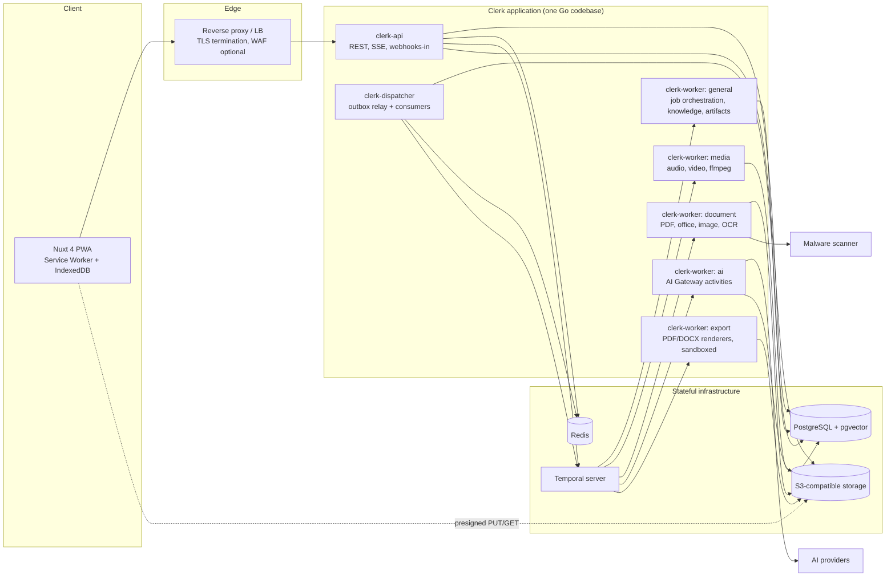

# Container Architecture

| Field | Value |
|---|---|
| Status | Accepted |
| Spec class | Implementation-ready |
| Version | 1.0.0 |
| Last Updated | 2026-09-28 |
| Owner | Technical Leadership |
| Blueprint | BP §6, §6.1 |

## Purpose

Deployable/runtime units, their responsibilities and communication. "Container" in the C4 sense (a separately running process or data store).

## Diagram



## Containers

| Container | Responsibility | Scaling | State |
|---|---|---|---|
| `web` (Nuxt 4 PWA) | UI, schema-form rendering, offline capture queue, SSE client | CDN/static + optional Nuxt server for public pages | IndexedDB on device |
| `clerk-api` | Authentication, authorization, REST commands/queries, upload sessions, SSE streams, inbound webhooks (payment), starts Temporal workflows | Horizontal, stateless | None |
| `clerk-dispatcher` | Reads `outbox_events`, publishes to EventBus, runs in-process consumers (audit projections, notifications, webhooks enqueue, SSE fan-out publish) | 1 active (leader lock) + standby; partitioned later | Consumer offsets in PostgreSQL |
| `clerk-worker` pools | Temporal task queues: `general`, `media`, `document`, `ai`, `export` (+ `webhook`) | Per queue, horizontal | None |
| PostgreSQL | System of record, RLS, pgvector, outbox, idempotency keys | Primary + replica; PITR | Durable |
| Redis | Caches, rate limits, SSE pub/sub, locks | Single primary + replica | Ephemeral |
| Object storage | Originals, renditions, extraction blobs, exports | Provider-managed | Durable |
| Temporal | Workflow execution state, timers, task queues | Cluster (dedicated persistence) | Execution state only |

Initial deployment may run `clerk-dispatcher` inside `clerk-worker:general` and a single worker process polling all queues; the split above is the target once load requires it. The binary is the same (`apps/worker` with `--queues` flag).

## Communication Rules

- Browser → API only (plus presigned object URLs). Browser never talks to Temporal, Redis or PostgreSQL.
- API → Temporal: start/signal/query/cancel workflows. API never executes long work inline (> ~2 s p95 budget).
- Workers never expose HTTP endpoints except health/metrics.
- Export workers run renderers in a sandbox without network egress ([rendering](../artifacts/rendering.md)).
- All containers export OTLP telemetry ([opentelemetry](../operations/opentelemetry.md)).

## Monorepo Mapping (BP §6.1)

```text
clerk/
├── apps/
│   ├── web/                 # Nuxt 4
│   ├── api/                 # Go API main
│   └── worker/              # Go worker main (queues via flags), dispatcher mode
├── internal/                # Go bounded contexts (see component-architecture)
├── modules/
│   ├── platform/hello/
│   ├── business/meeting-minutes/
│   ├── construction/site-report/
│   ├── general/handwriting-document/
│   └── education/lecture-summary/
├── packages/
│   ├── web-sdk/             # generated TS client
│   ├── module-spec/         # manifest JSON Schema + validator CLI
│   └── shared-schemas/      # event, evidence, artifact schemas
├── deployments/             # compose, IaC
├── migrations/
└── docs/                    # this documentation (adr/pdr/bdr under docs/governance)
```

Note: BP §6.1 shows `docs/adr`, `docs/pdr`, `docs/bdr`. This documentation places them under `docs/governance/` as part of the documentation architecture; this is a location refinement, not a decision change.
