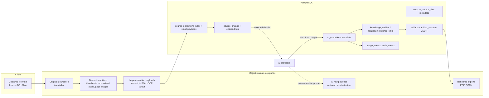

# Data Flow Architecture

| Field | Value |
|---|---|
| Status | Accepted |
| Spec class | Baseline |
| Version | 1.0.0 |
| Last Updated | 2026-09-28 |
| Owner | Technical Leadership |
| Blueprint | BP §8, §9, §10, §11, §12, §15 |

## Purpose

Shows how customer data moves through the platform, which store holds each representation, and where classification, retention and trust boundaries apply.

## Data Representations

## Classification and Retention by Representation

| Representation | Classification default | Retention category | Deletion trigger |
|---|---|---|---|
| Original audio/video | Confidential | `raw_media` (default 90 days self-service, configurable) | Retention sweep, source delete, org delete |
| Original image/document | Confidential | `raw_documents` (until deletion/policy) | Source delete, policy |
| Renditions | Confidential | Follows original | Cascades from original |
| Extractions and chunks | Confidential | `derived_content` (aligned with Job/Artifact lifetime) | Source delete (unless held by legal hold), policy |
| AI raw request/response | Confidential/Restricted | `ai_raw_payloads` (≤ 30 days; Enterprise may disable storage) | Policy sweep |
| Knowledge + Evidence | Confidential | `knowledge` (aligned with Artifact/Job) | Job/Artifact delete |
| Artifact versions and exports | Confidential | `artifacts` (until org deletion/policy) | Artifact delete, policy |
| Audit events | Internal/Restricted | `audit` (≥ 365 days Business; longer Enterprise) | Policy only |
| Usage events | Internal | `usage` (billing/legal retention) | Policy only |

Canonical categories: [data-retention](../privacy/data-retention.md). Classification: [data-classification](../privacy/data-classification.md).

## Trust Boundaries Crossed

1. Client → object storage (presigned; untrusted bytes).
2. Object storage → parsers (sandboxed; untrusted structure).
3. Platform → AI provider (data minimisation, tenant AI policy, provider terms).
4. AI provider → platform (untrusted output; schema validation, sanitisation).
5. Platform → renderers (sanitised structured content only).
6. Platform → webhooks (minimal payloads, signed).

## Evidence Integrity Across Deletion

When an original Source is deleted by retention while Artifacts remain, Evidence links remain as records but resolve to `source_unavailable` with retained metadata (source name, page/time reference). Artifacts never break ([evidence-model](../knowledge/evidence-model.md)).
