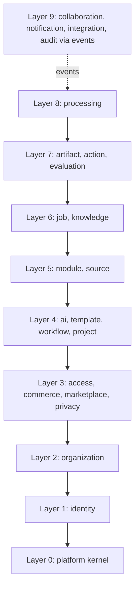

# Dependency Rules

| Field | Value |
|---|---|
| Status | Accepted |
| Spec class | Implementation-ready |
| Version | 1.0.0 |
| Last Updated | 2026-09-28 |
| Owner | Tech Lead (Go) |
| Blueprint | BP §0, §6, §7 |

## Purpose

Rules that keep the Modular Monolith modular, and how CI enforces them.

## Rules

| ID | Rule |
|---|---|
| DR-01 | A context may import another context **only** through its `api.go` facade package (`internal/<ctx>` root package), never `domain`, `app`, `ports` or `adapters` of another context. |
| DR-02 | Dependencies between contexts must follow the allowed edges in [bounded-contexts](bounded-contexts.md). The graph is acyclic. New edges require architecture review. |
| DR-03 | A context never reads or writes another context's tables (no cross-context SQL joins, no shared repositories). Read models needed across contexts are built via facades or event-fed projections owned by the consumer. |
| DR-04 | `internal/platform/*` contains only technical kernel code. Business rules are forbidden there. |
| DR-05 | `internal/*` must not import `modules/*` or contain module key literals (INV-07). |
| DR-06 | Domain packages must not import SQL, HTTP, Temporal, Redis or provider SDKs. |
| DR-07 | Upstream contexts must not depend on downstream ones to avoid cycles; downstream reactions use events. Example: Commerce reacts to `organization.created` rather than Organizations calling Commerce. |
| DR-08 | Synchronous facade calls across contexts inside a single transaction are allowed only where the Blueprint requires atomicity (for example Job submit + usage reservation). Prefer events otherwise. |
| DR-09 | Sinks (`AuditWriter`, `UsageRecorder`, `Outbox`) are ports in `internal/platform`; any context may use them. |
| DR-10 | Frontend depends on the REST API only; no knowledge of module processing internals (BP §8). |

## Allowed Dependency Layers

A context may depend on contexts in lower layers only. Contexts in the same layer do not depend on each other. Two inversions keep the graph acyclic:

- **Workflow → Artifacts:** Workflow (L4) never imports Artifacts (L7). It defines a `SubjectStatusPort` (set status of the approval subject) which Artifacts implements and the composition root injects. Workflow is thus reusable for any approvable subject.
- **Actions → Artifacts:** Action Items reference Artifacts by ID only (no facade call); display data is resolved by the API layer.

## Enforcement in the Go Modular Monolith

| Mechanism | What it checks | When |
|---|---|---|
| Import-boundary linter (`go-arch-lint` or a `go list -deps` script) | DR-01, DR-02, DR-05, DR-06 | Every PR (CI blocking) |
| Table-ownership lint | SQL files/queries in `internal/<ctx>/adapters/postgres` reference only tables owned by `<ctx>` (from [entity-catalog](../data/entity-catalog.md) ownership map) | Every PR (CI blocking) |
| Per-context DB schema (optional hardening) | Each context's tables in its own PostgreSQL schema; repository role grants per schema | Future, before extraction |
| Module-literal scan | grep for known module keys and `construction`/`meeting` identifiers in `internal/` | Every PR |
| Architecture review | New context edges, new facade methods | PR label `architecture` |

## Related Documents

[component-architecture](component-architecture.md), [future-service-extraction](future-service-extraction.md), [code-review-standards](../execution/code-review-standards.md)
