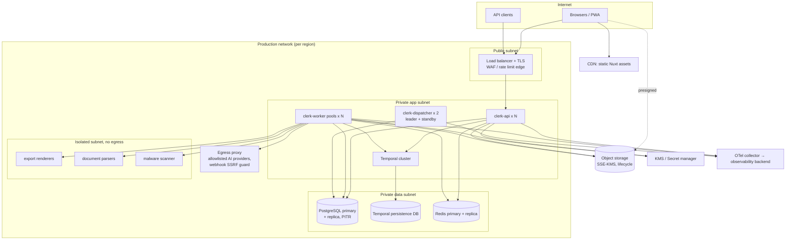

# Deployment Architecture

| Field | Value |
|---|---|
| Status | Accepted |
| Spec class | Baseline (provider choices Open) |
| Version | 1.0.0 |
| Last Updated | 2026-09-28 |
| Owner | DevOps / SRE |
| Blueprint | BP §6, §17.1, §18 |

## Purpose

Target deployment topology per environment. Hosting provider, orchestrator and managed services are open ([OD-005](../governance/open-decisions.md#od-005), [OD-029](../governance/open-decisions.md#od-029), [OD-006](../governance/open-decisions.md#od-006)).

## Production Topology (target)

Decisions shown:
- Data stores are never publicly reachable.
- Parsers, renderers and malware scanning run in an isolated network without internet egress.
- All outbound calls (AI providers, customer webhooks) go through an egress proxy that allowlists providers and blocks internal/metadata addresses for webhooks.
- Temporal uses its own persistence database, separate from the Clerk business database.

## Environment Variants

| Environment | Topology | Notes |
|---|---|---|
| Local | Docker Compose: PostgreSQL+pgvector, Redis, MinIO, Temporal (dev server), Mailpit, OTel collector + Jaeger, mock AI provider | [environments](../operations/environments.md) |
| CI | Ephemeral containers (Testcontainers or service containers) | |
| Staging | Production-like, smaller; non-production provider keys; synthetic/redacted data | |
| Production | As above; KMS-managed keys; backups; monitoring | |
| Preview (optional) | Frontend previews with synthetic data | |

## Availability Targets (provisional, BP §17.1)

API availability 99.9% at Paid Launch; RPO ≤ 15 min for production metadata; RTO ≤ 4 h at launch. See [sli-slo](../operations/sli-slo.md) and [disaster-recovery](../operations/disaster-recovery.md).

## Release Strategy

Container images signed; SBOM attached; staging → production canary → full rollout; database migrations expand/contract ([deployment](../operations/deployment.md), [migration-strategy](../data/migration-strategy.md)).
