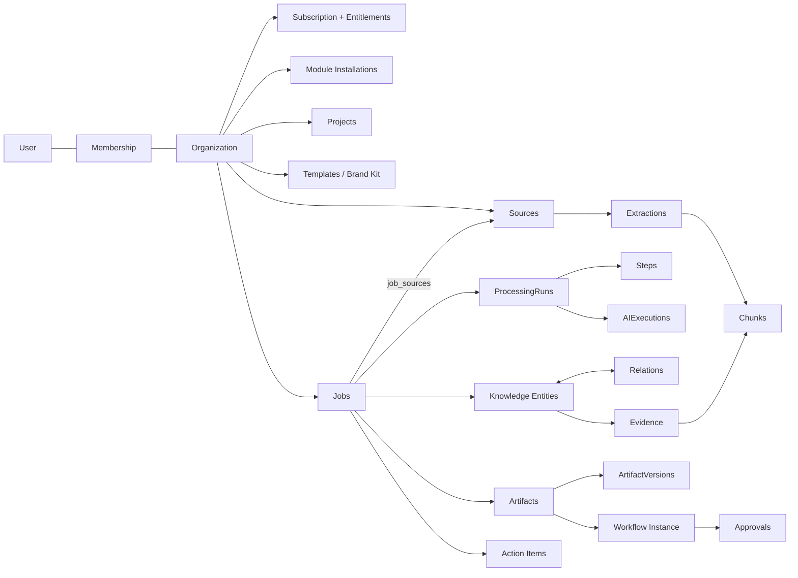

# Domain Architecture

| Field | Value |
|---|---|
| Status | Accepted |
| Spec class | Baseline |
| Version | 1.0.0 |
| Last Updated | 2026-09-28 |
| Owner | Technical Leadership |
| Blueprint | BP §7, §7.1 |

## Purpose

Explains the core domain model: how aggregates relate across contexts and where each consistency boundary lies. Context-level details are in [bounded-contexts](bounded-contexts.md); table-level details in [entity-catalog](../data/entity-catalog.md).

## Core Aggregate Graph (BP §7.1)

Difference from BP §7.1: Sources are shown as organization-owned and attached to Jobs through `job_sources`, reflecting [PDR-004](../governance/pdr/PDR-004-source-reusability.md) (BP §7.1 draws Sources under Jobs for readability).

## Aggregates and Consistency Boundaries

| Aggregate root | Contains | Consistency rule | Cross-aggregate references |
|---|---|---|---|
| Organization | settings, locale, data_region | Single-row updates, optimistic lock | — |
| Membership | roles (assignments) | One active membership per (org, user) | User, Organization by ID |
| ModuleInstallation | configuration versions, assignments | One installation per (org, module) | ModuleVersion by ID (pinned) |
| Source | SourceFiles, Extractions (versioned), Chunks | Original file immutable; extractions append-only per pipeline version | Organization |
| Job | JobSources, pinned module/workflow version | State machine transitions under row lock | Sources, ModuleVersion, Project by ID |
| ProcessingRun | Steps | One active run per Job | Job by ID |
| Knowledge Entity | attributes, review state | Corrections append a revision | Job, Evidence |
| Artifact | ArtifactVersions (append-only), current pointer | `current_version_id` updated with optimistic concurrency | Job, Knowledge, Template |
| WorkflowInstance | ApprovalRequests, Decisions | Decisions append-only; completion condition evaluated transactionally | Artifact version |
| ActionItem | status history | Status transitions validated | Knowledge entity, Artifact |
| Subscription | seats, add-ons | One active subscription per org | PlanVersion |

## Domain Rules That Span Aggregates

1. **Submit pins versions:** Job submit captures `module_version_id`, `workflow_version_id` and configuration version ([job-domain](../jobs/job-domain.md)).
2. **Artifact generation pins provenance:** each AI ArtifactVersion records `processing_run_id`, prompt versions and model IDs used ([provenance](../knowledge/provenance.md)).
3. **Approval targets a specific ArtifactVersion;** by default the artifact is locked while in review; if the workflow allows `supersede`, a new edit invalidates pending approval requests (they become `superseded`) ([approval-lifecycle](../artifacts/approval-lifecycle.md)).
4. **Action Items survive Artifact edits;** removal of the underlying Knowledge item marks the Action as `orphaned` for review, not deleted.

## Related Documents

[bounded-contexts](bounded-contexts.md), [erd](../data/erd.md), [artifact-lifecycle](artifact-lifecycle.md)
