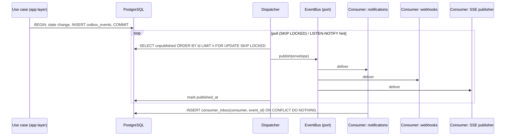

# Event Architecture

| Field | Value |
|---|---|
| Status | Accepted |
| Spec class | Implementation-ready |
| Version | 1.0.0 |
| Last Updated | 2026-09-28 |
| Owner | Tech Lead (Go) |
| Blueprint | BP §8, §8.2, §8.3 |

## Purpose

Canonical specification of domain events: naming, envelope, publication (Transactional Outbox), delivery semantics, consumers, versioning, and how events relate to Temporal and to webhooks. Decision: [ADR-007](../governance/adr/ADR-007-event-architecture.md).

## Scope / Non-goals

- In scope: in-platform domain events, public (webhook-exposed) event subset.
- Not in scope: Temporal signals (execution control), SSE frames ([api/sse](../api/sse.md)) — these are derived from events/state but have their own contracts.

## 1. Naming Convention

```text
<domain>.<entity>.<event>      e.g. source.file.uploaded, artifact.export.completed
<domain>.<event>               when the entity is the domain's aggregate root, e.g. job.submitted, artifact.generated
```

- Lowercase, dot-separated, `snake_case` segments if multiword (`approval.decided`, `quota.threshold.reached`).
- `<event>` is past tense (a fact), never an imperative.
- Module-specific events are namespaced by module key and are emitted only through platform step types: `module.<module-key>.<event>` is **reserved**; v1 modules do not emit custom events.

## 2. Envelope

Schema: [event-envelope.schema.json](../api/schemas/event-envelope.schema.json) (JSON Schema 2020-12). Baseline from BP §8.2, extended:

```json
{
  "event_id": "0192f4a8-7c1e-7a3b-9d2e-4b5c6d7e8f90",
  "event_type": "artifact.generated",
  "version": 1,
  "occurred_at": "2026-09-28T10:15:30.123Z",
  "organization_id": "0192f4a8-0000-7000-8000-000000000001",
  "actor": { "type": "system", "id": null },
  "actor_id": null,
  "correlation_id": "0192f4a8-1111-7000-8000-000000000002",
  "causation_id": "0192f4a8-2222-7000-8000-000000000003",
  "subject": { "type": "artifact", "id": "0192f4a8-3333-7000-8000-000000000004" },
  "trace": { "traceparent": "00-...-...-01" },
  "data": { "artifact_id": "…", "version_id": "…", "job_id": "…", "module_key": "business.meeting-minutes" }
}
```

| Field | Rule |
|---|---|
| `event_id` | UUIDv7, globally unique, dedup key. |
| `event_type` | As §1. |
| `version` | Integer schema version of `data` for this `event_type`. |
| `occurred_at` | RFC 3339 UTC, time of the state change (transaction time). |
| `organization_id` | Required for tenant events; `null` only for platform-scoped events (for example `module.version.published`). |
| `actor_id` / `actor` | Actor who caused it. `actor.type ∈ {user, api_key, system, ai, remote_module}`. `actor_id` kept for BP compatibility. |
| `correlation_id` | End-to-end operation id (from the originating request). |
| `causation_id` | `event_id` or `request_id` that directly caused this event. |
| `data` | Minimal payload: IDs and small facts. **No customer content** (no transcript text, no artifact content). Consumers fetch details through facades with authorization. |

## 3. Publication: Transactional Outbox



- `outbox_events(id BIGINT identity, event_id UUID unique, organization_id, event_type, version, payload JSONB, occurred_at, published_at NULL, attempts, last_error)`.
- Dispatcher ordering: by `id` (commit order approximation). **Ordering guarantee:** per-aggregate order is preserved when consumers process events of one subject sequentially; global order is not guaranteed.
- `LISTEN/NOTIFY` may be used as a wake-up hint only; polling is the correctness mechanism.
- Cleanup: published rows older than 7 days are deleted or partitions dropped ([partitioning-strategy](../data/partitioning-strategy.md)).

## 4. Delivery Semantics

| Property | Guarantee |
|---|---|
| Delivery | At-least-once. |
| Deduplication | Consumer inbox table `consumer_inbox(consumer_name, event_id)` in the consumer's transaction. |
| Ordering | Per subject, best-effort in v1 dispatcher; consumers must tolerate reordering using entity versions/timestamps. |
| Retry | Per consumer with exponential backoff; after N attempts (default 10) the event goes to `consumer_dead_letters` and an alert fires. |
| Replay | Supported from outbox retention window; longer replay via rebuild from source tables. |

## 5. Event Bus Evolution

| Stage | Implementation | Trigger to move |
|---|---|---|
| v1 | Outbox + in-process dispatcher + in-process consumer registry | — |
| v1.x | Outbox relay → NATS JetStream (or Redis Streams) | External consumers, multiple dispatcher instances, throughput > dispatcher capacity ([OD-007](../governance/open-decisions.md#od-007)) |
| Future | Outbox relay → Kafka-class log | Very high volume / analytics fan-out |

Domain code depends only on `platform/outbox.Writer` and `platform/eventbus.Consumer` interfaces; changing the transport changes only adapters and deployment.

## 6. Events vs Temporal vs Business History

| Mechanism | Purpose | System of record? |
|---|---|---|
| PostgreSQL tables | Business state and history (jobs, runs, steps, approvals, versions, audit) | **Yes** |
| Temporal | Durable orchestration state (what to do next, timers, retries) | No |
| Events | Notify other contexts/integrations that a fact happened | No |

Rules: a Temporal workflow reacts to external facts via **signals** sent by consumers or API (for example `approval.decided` → signal `ApprovalDecided`), not by subscribing to the bus directly. Events are never used to request work from another context ("commands via events" are forbidden); use facades or Temporal.

## 7. Event Catalogue (v1 baseline)

| Event type | Producer | Key data | Typical consumers | Public (webhook) |
|---|---|---|---|---|
| `organization.created` | organization | org_id, kind | commerce (default plan), notification | No |
| `organization.member.joined` / `.removed` | organization | membership_id, user_id | access cache, notification, commerce (seats) | Yes |
| `access.role.changed` | access | role_id | authz cache invalidation | No |
| `subscription.changed` | commerce | subscription_id, plan_version_id | entitlement cache, notification | Yes |
| `entitlement.changed` | commerce | keys | entitlement cache, module (suspend if lost) | No |
| `usage.recorded` | commerce | meter, quantity, job_id | aggregates, anomaly detection | No |
| `quota.threshold.reached` / `quota.exceeded` | commerce | meter, percent | notification | Yes |
| `module.version.published` | module | module_key, version | store cache | No |
| `module.installed` / `.enabled` / `.disabled` / `.upgraded` / `.suspended` / `.uninstalled` | module | installation_id, module_key, version | access (permissions), notification, cache | Yes |
| `module.configuration.changed` | module | installation_id, config_version | cache | No |
| `source.upload.created` | source | upload_session_id | — | No |
| `source.file.uploaded` | source | source_id, file_id, sha256 | ingestion workflow starter | Yes |
| `source.scan.completed` / `source.quarantined` | source | source_id, verdict | notification, security | No |
| `source.processing.completed` / `.failed` | source | source_id, extraction kinds | job workflows (signal) | Yes |
| `source.deleted` | source | source_id | knowledge (evidence availability), privacy | No |
| `job.created` | job | job_id, module_key | — | No |
| `job.submitted` | job | job_id, run_id, module_version | SSE, notification, usage | Yes |
| `job.processing.started` | job | job_id, run_id | SSE | Yes |
| `job.review.required` | job | job_id, review_item_count | notification, SSE | Yes |
| `job.processing.completed` | job | job_id, run_id, artifact_ids | notification, SSE | Yes |
| `job.failed` / `job.cancelled` | job | job_id, reason code | notification, SSE | Yes |
| `processing.step.completed` | processing | run_id, step_key, status | SSE | No |
| `ai.execution.completed` / `.failed` | ai | ai_execution_id, profile, outcome | cost anomaly, provider health | No |
| `ai.provider.degraded` | ai | provider_key | alerting, router | No |
| `knowledge.review.required` | knowledge | job_id, items | review queue projections | No |
| `knowledge.item.confirmed` / `.modified` / `.rejected` | knowledge | entity_id, previous_state | evaluation candidate pipeline, actions | No |
| `artifact.generated` | artifact | artifact_id, version_id, job_id | notification | Yes |
| `artifact.version.created` | artifact | artifact_id, version_id, origin | approval (supersede pending) | Yes |
| `artifact.submitted` | artifact | artifact_id, version_id | workflow | No |
| `approval.requested` / `approval.decided` | workflow | request_id, decision | notification, artifact status | Yes |
| `artifact.approved` / `artifact.finalized` | artifact | artifact_id, version_id | actions, notification | Yes |
| `artifact.export.completed` / `.failed` | artifact | export_id, format | notification, SSE | Yes |
| `action.created` / `.updated` / `.overdue` / `.resolved` | action | action_id | notification | Yes |
| `webhook.delivery.failed` | integration | endpoint_id | notification | No |
| `privacy.deletion.requested` / `.completed` | privacy | request_id, scope | all owning contexts (deletion handlers) | No |

Audit is **not** produced from events; audit records are written in-transaction ([audit-model](../platform/audit/audit-model.md)).

## 8. Versioning

- Additive changes (new optional fields) keep `version`.
- Breaking changes increment `version`; producers emit both versions during a deprecation window for public (webhook) events; internal consumers are migrated in the same release.
- Each `(event_type, version)` has a JSON Schema in `packages/shared-schemas/events/` validated in contract tests ([contract-testing](../testing/contract-testing.md)).

## 9. Security and Privacy

- Payloads contain identifiers, not content; webhook payloads are further filtered to public fields.
- Tenant identity is mandatory; consumers re-establish `TenantContext` from `organization_id` before any read.
- Events are not audit records and may be purged.

## 10. Observability

Metrics: outbox lag (oldest unpublished age), publish rate, consumer lag per consumer, dead-letter count. Alerts: outbox lag > 60 s (provisional), any dead letter.

## Related Documents

[idempotency-strategy](idempotency-strategy.md), [webhooks](../api/webhooks.md), [workflow-architecture](workflow-architecture.md), [event-envelope.schema.json](../api/schemas/event-envelope.schema.json)
