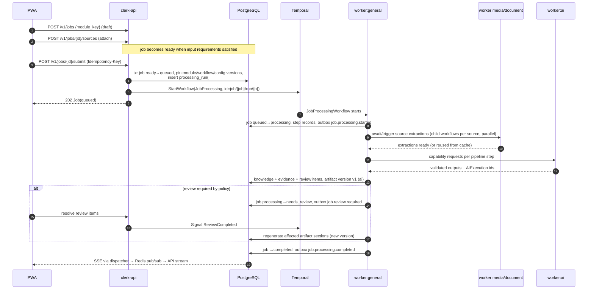

# Job Lifecycle (Architecture View)

| Field | Value |
|---|---|
| Status | Accepted |
| Spec class | Baseline |
| Version | 1.0.0 |
| Last Updated | 2026-09-28 |
| Owner | Jobs domain |
| Blueprint | BP §8.1 |

## Purpose

Shows how the Job lifecycle spans API, PostgreSQL, Temporal, workers and SSE. The **canonical state machine** (states, transitions, guards) is in [jobs/job-state-machine.md](../jobs/job-state-machine.md); this document does not redefine it.

## Job Processing Lifecycle

## Key Properties

- **Draft is cheap:** attaching Sources does not start Job processing (BP §8.1). Source-level preprocessing may start at upload because it is reusable across Jobs.
- **Pinning:** module version, workflow version and configuration version are pinned at submit ([INV-06](../governance/architecture-principles.md#architectural-invariants-testable)).
- **Runs:** every submit/retry/reprocess creates a new ProcessingRun ([processing-runs](../jobs/processing-runs.md)).
- **Durability:** worker crash or timeout never loses a Job; Temporal resumes (BP App. D).
- **Parallelism:** Sources are processed in parallel child workflows; fusion waits for all required ones.
- **Human wait:** `needs_review` is a durable wait (Temporal signal/timer); reminders via timers.

## Related Documents

[job-state-machine](../jobs/job-state-machine.md), [temporal-workflows](../jobs/temporal-workflows.md), [processing-steps](../jobs/processing-steps.md), [api/sse](../api/sse.md)
