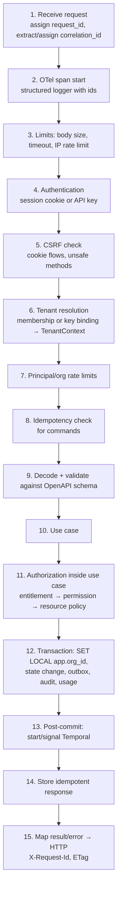

# Request Lifecycle

| Field | Value |
|---|---|
| Status | Accepted |
| Spec class | Implementation-ready |
| Version | 1.0.0 |
| Last Updated | 2026-09-28 |
| Owner | Tech Lead (Go) |
| Blueprint | BP §8, §13, §14.2, §17 |

## Purpose

Exact order of middleware and checks for every HTTP request to `clerk-api`.

## Pipeline

## Rules

- `request_id`: generated per request (UUIDv7), returned as `X-Request-Id`, included in every error body.
- `correlation_id`: accepted from `X-Correlation-Id` only for authenticated first-party clients; otherwise generated. Propagated to Temporal and events.
- Authorization happens in the **use case**, not only in middleware, so object-level checks see the loaded resource (BOLA protection).
- Post-commit Temporal start failure does not roll back the business change; a reconciler detects `queued` jobs without a running workflow and starts them ([failure-model](failure-model.md)).
- Response time budget: non-processing endpoints p95 < 500 ms (provisional SLO, BP §17.1).

## Related Documents

[api-principles](../api/api-principles.md), [authorization-model](../platform/access/authorization-model.md), [idempotency](../api/idempotency.md), [errors](../api/errors.md)
