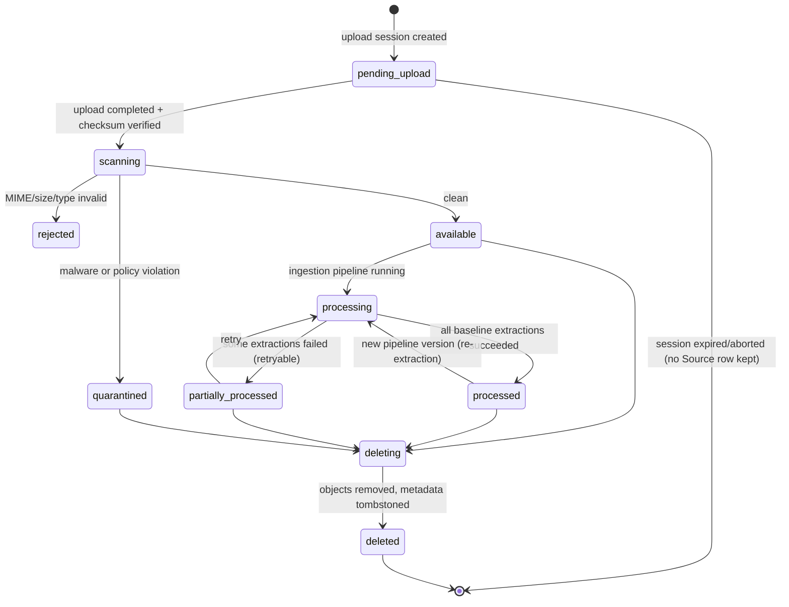

# Source Lifecycle (Architecture View)

| Field | Value |
|---|---|
| Status | Accepted |
| Spec class | Baseline |
| Version | 1.0.0 |
| Last Updated | 2026-09-28 |
| Owner | Sources domain |
| Blueprint | BP §9, §9.1 |

## Purpose

End-to-end lifecycle of a Source from upload session to deletion. Canonical entity definitions: [source-model](../ingestion/source-model.md). Upload protocol: [upload-flow](../ingestion/upload-flow.md).

## States

Notes:
- A `Source` row is created at upload completion (BP App. B: "Confirm upload and create Source"); the upload session itself is tracked in `upload_sessions`. The `pending_upload` state belongs to the session; it is shown here for completeness.
- Text/manual note Sources skip `scanning` for binary content but still pass content validation.
- `processed` means baseline extractions for the source type exist; Jobs may request additional extraction kinds later (for example diarization) which run on demand and are cached.

## Lifecycle Rules

- **Immutability:** original bytes never change. Replacing a file creates a new Source with `replaces_source_id` ([source-model](../ingestion/source-model.md)).
- **Reuse:** attaching to additional Jobs never re-uploads or re-extracts when a compatible extraction exists ([extraction-cache](../ingestion/extraction-cache.md)).
- **Dedup:** same SHA-256 within the same organization may reuse the existing Source's file and extractions ([deduplication](../ingestion/deduplication.md)).
- **Deletion:** allowed by policy; if referenced by final Artifacts, evidence resolves to `source_unavailable`. Deletion is asynchronous and audited.

## Related Documents

[universal-ingestion](../ingestion/universal-ingestion.md), [malware-scanning](../ingestion/malware-scanning.md), [deletion](../privacy/deletion.md)
