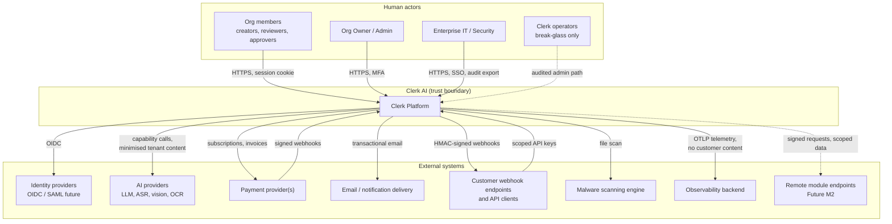

# System Context

| Field | Value |
|---|---|
| Status | Accepted |
| Spec class | Baseline |
| Version | 1.0.0 |
| Last Updated | 2026-09-28 |
| Owner | Technical Leadership |
| Blueprint | BP §2, §6, §8, §11, §15.3, §22 |

## Purpose

Shows Clerk as a single system with its human actors and external systems, and the trust boundary for each interaction.

## Diagram

## Interfaces and Trust

| Counterparty | Direction | Data crossing | Controls | Owner doc |
|---|---|---|---|---|
| End users | In | Commands, Sources, edits | Auth, CSRF, CSP, object-level authz | [authentication-security](../security/authentication-security.md) |
| Identity providers | Out/In | Identity assertions | OIDC state/nonce/PKCE | [identity-providers](../platform/identity/identity-providers.md) |
| AI providers | Out | Tenant content chunks, prompts | Provider registry, tenant AI policy, data-processing terms, no-training settings, redaction | [ai-security](../security/ai-security.md), [ai-data-usage](../privacy/ai-data-usage.md) |
| Payment provider | Both | Customer billing identity, invoices | Signed webhooks, idempotent handlers | [billing-architecture](../billing/billing-architecture.md) |
| Customer webhooks | Out | Event payloads (minimal) | HMAC, timestamp, retries, SSRF protection | [webhook-security](../security/webhook-security.md) |
| API clients | In | Commands and reads | Scoped, hashed API keys; rate limits | [api-keys](../api/api-keys.md) |
| Malware scanner | Out | File bytes | Isolated network, no egress | [malware-protection](../security/malware-protection.md) |
| Observability backend | Out | Telemetry without customer content | Redaction rules | [logging](../operations/logging.md) |
| Remote modules (future) | Out/In | Scoped job data | Remote Module Gateway, request signing | [remote-modules](../marketplace/remote-modules.md) |

Provider data-processing terms are registered in a Vendor Registry (BP §15.3) — see [regional-data-considerations](../privacy/regional-data-considerations.md).
