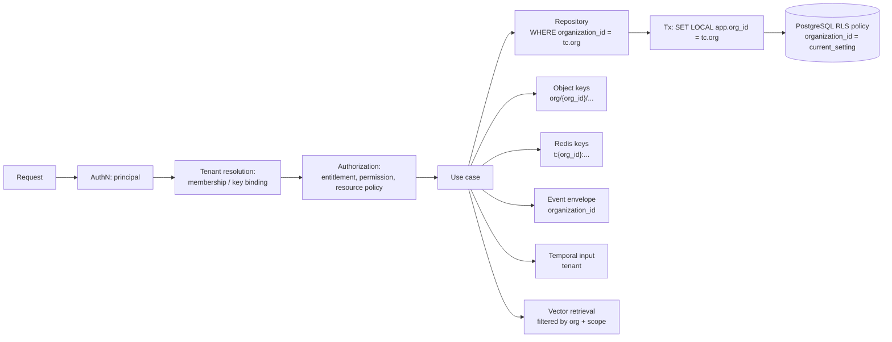

# Tenancy Architecture

| Field | Value |
|---|---|
| Status | Accepted |
| Spec class | Implementation-ready |
| Version | 1.0.0 |
| Last Updated | 2026-09-28 |
| Owner | Tech Lead (Go) + Security |
| Blueprint | BP §1.1, §2, §7.2, §14.1, §14.2, App. D |

## Purpose

Canonical specification of multi-tenancy: tenant model, tenant context propagation across every runtime surface, and the two isolation layers. Decision: [ADR-013](../governance/adr/ADR-013-multi-tenant-isolation.md). Database specifics: [tenant-data-isolation](../data/tenant-data-isolation.md). Security testing: [security/tenant-isolation](../security/tenant-isolation.md).

## 1. Tenant Model

- **Tenant = Organization** (`organizations.id`). Personal workspaces are organizations ([PDR-008](../governance/pdr/PDR-008-personal-workspace-as-organization.md)).
- A User may hold memberships in many Organizations; every request operates in **exactly one** organization.
- Platform-scoped data (plans, entitlement definitions, public module catalog, AI providers/models, prompt registry, publishers) has no `organization_id`, is read-only to tenants, and is writable only via platform-admin paths.

## 2. Tenant Context

```go
// internal/platform/tenant (illustrative)
type Context struct {
    OrganizationID ids.OrgID
    Principal      Principal   // user | api_key | system | remote_module
    MembershipID   *ids.MembershipID
    ActingFor      *ids.UserID // for system work on behalf of a user
    DataRegion     string
    RequestID      string
    CorrelationID  string
}
```

Resolution rules:

| Surface | How the organization is determined | Validation |
|---|---|---|
| Browser session | `Clerk-Organization-Id` header (active workspace) | Active membership required; else `403 ORG_ACCESS_DENIED` |
| API key | Key is bound to exactly one organization | Header, if sent, must match |
| Temporal workflow | `tenant` field in workflow input (organization_id, acting principal) | Activities re-validate that referenced resources belong to it |
| Event consumer | Envelope `organization_id` | Consumer builds a `system` principal context |
| Scheduled platform jobs (retention sweeps) | Iterate organizations explicitly | Each iteration runs with its own context |

`TenantContext` is immutable, created once at the boundary, and passed explicitly to every repository and facade method.

## 3. Isolation Layers



| Layer | Control | Failure it catches |
|---|---|---|
| 1. Application guard | Membership validation, object-level authorization, explicit tenant filter in every query | Normal operation |
| 2. RLS | `FORCE ROW LEVEL SECURITY` with `organization_id = current_setting('app.org_id')::uuid` | Missing/incorrect `WHERE` in a query; ID-guessing (BOLA) |
| 3. Storage/key layout | Object keys and cache keys prefixed with org | Presign/cache mistakes |
| 4. Tests | BOLA suite, RLS tests, cross-tenant fixtures in CI | Regressions |

If `app.org_id` is unset, RLS policies evaluate to no rows (`current_setting('app.org_id', true)` returns NULL → predicate false). Writes with mismatching `organization_id` fail `WITH CHECK`.

## 4. Per-Surface Requirements

| Surface | Requirement |
|---|---|
| PostgreSQL | Every tenant table has `organization_id NOT NULL`; composite FKs `(organization_id, id)` for child tables where cross-tenant references would otherwise be possible ([tenant-data-isolation](../data/tenant-data-isolation.md)). |
| Object storage | Keys `org/{organization_id}/...`; presigned URLs only generated after authorization for that exact key; no listing permissions for application credentials beyond needed prefixes ([object-storage-layout](../data/object-storage-layout.md)). |
| Redis | Keys `t:{organization_id}:<purpose>:...`; no unprefixed tenant data; cache values include `organization_id` and are checked on read ([redis-usage](../data/redis-usage.md)). |
| Temporal | Workflow input carries tenant; workflow IDs include resource IDs (unique globally); search attributes include `OrganizationId` for operations. |
| Events | `organization_id` mandatory for tenant events; consumers never act on other orgs' resources. |
| AI | Prompts assembled only from the current tenant's chunks; retrieval filtered by org and job/project scope; provider calls tagged with an opaque tenant hash, never names. |
| Logs/traces | `organization_id` allowed as attribute; never tenant content ([logging](../operations/logging.md)). |
| Search/vector | Filter before rank; RLS on embeddings table. |
| Exports/renders | Renderer receives only the artifact version and template for the tenant; output key under tenant prefix. |
| Webhooks | Endpoint bound to one org; deliveries include only that org's events. |
| Platform admin | Separate role and path; every access audited; break-glass per [OD-040](../governance/open-decisions.md#od-040). |

## 5. Cross-Tenant Scenarios (explicitly forbidden)

- Sharing a Source/Artifact across organizations (future cross-org sharing requires a PDR and explicit share objects).
- Deduplication across organizations: SHA-256 dedup is **tenant-level only** (BP §9.1) to prevent cross-tenant existence oracles.
- Extraction cache reuse across organizations — forbidden for the same reason.

## 6. Data Region (architecture-ready)

`organizations.data_region` exists from v1 with a single value; routing of storage buckets, AI providers and databases by region is future work ([OD-028](../governance/open-decisions.md#od-028)).

## Related Documents

[tenant-data-isolation](../data/tenant-data-isolation.md), [security/tenant-isolation](../security/tenant-isolation.md), [authorization-model](../platform/access/authorization-model.md)
