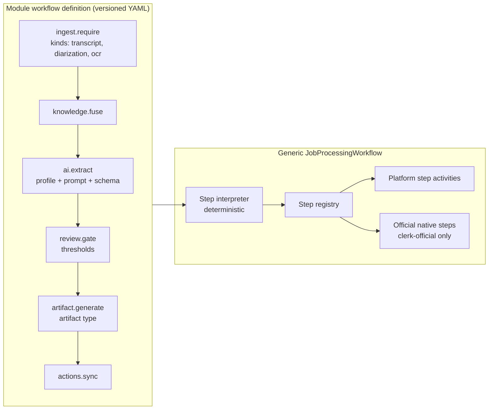

# Workflow Architecture

| Field | Value |
|---|---|
| Status | Accepted |
| Spec class | Implementation-ready (processing + approval); Provisional (definition DSL, [OD-018](../governance/open-decisions.md#od-018)) |
| Version | 1.0.0 |
| Last Updated | 2026-09-28 |
| Owner | Tech Lead (Go) |
| Blueprint | BP §7 (Workflow context), §8, §12, §24 (G7, G10) |

## Purpose

Defines the two meanings of "workflow" and how they fit together:

1. **Processing workflows** — Temporal workflows that execute a module's pipeline for a Job.
2. **Business workflows** — review/approval/sign-off processes defined by Workflow Definitions and persisted as Workflow Instances in PostgreSQL.

See the disambiguation in the [glossary](../governance/glossary.md#disambiguation).

## 1. Processing Workflows

| Workflow | ID pattern | Queue | Started by |
|---|---|---|---|
| `SourceIngestionWorkflow` | `source/{source_id}/ingest/{pipeline_version}` | general (+ child activities on media/document/ai) | upload completion |
| `JobProcessingWorkflow` | `job/{job_id}/run/{run_no}` | general | job submit/retry/reprocess |
| `ArtifactExportWorkflow` | `export/{export_id}` | export | export request |
| `ApprovalWorkflow` | `approval/{workflow_instance_id}` | general | submit-for-approval |
| `ModuleInstallWorkflow` | `module-install/{installation_id}/{operation_id}` | general | install/upgrade/uninstall |
| `RetentionSweepWorkflow` | `retention/{organization_id}/{date}` | general | schedule |
| `WebhookDeliveryWorkflow` (if [OD-035](../governance/open-decisions.md#od-035) chooses Temporal) | `webhook/{delivery_id}` | webhook | event consumer |

### Module Pipeline Interpretation (declarative-first)

`JobProcessingWorkflow` is **generic**. It loads the pinned module workflow definition (from the ModuleVersion package) and interprets it as a DAG of platform step types:



- Step types, parameters and validation: [workflow-reference](../modules/sdk/workflow-reference.md).
- The interpreter is deterministic; definitions are loaded via an activity at run start and passed as workflow state, so a module upgrade never changes a running workflow.
- Temporal workflow code versioning (`workflow.GetVersion`) is used for changes to the interpreter itself ([temporal-workflows](../jobs/temporal-workflows.md)).

## 2. Business Workflows (Review, Approval, Sign-off)

Data model (owned by the Workflow context):

| Entity | Meaning |
|---|---|
| `workflow_definitions` | Named workflow, scope `platform`, `module` (registered from manifest) or `organization` (customised). |
| `workflow_versions` | Immutable versioned definition: ordered/parallel approval stages, approver rules (role, user, team, project role), quorum, due times, escalation. |
| `workflow_instances` | Running instance bound to a subject (`artifact`, version), status. |
| `approval_requests` | Per-stage request to approver(s). |
| `approval_decisions` | Append-only decisions: `approve`, `reject`, `request_changes`, with comment and signature metadata. |

Workflow instance states: `active`, `completed_approved`, `completed_rejected`, `changes_requested`, `cancelled`, `superseded`. Artifact status is updated from instance outcomes through `SubjectStatusPort` ([approval-lifecycle](../artifacts/approval-lifecycle.md)).

Examples (configuration, not code):

```yaml
# Site Report approval chain
stages:
  - key: engineer_signoff
    approvers: { rule: job_creator }
  - key: pm_review
    approvers: { rule: project_role, role: project_manager }
    quorum: 1
    due: P2D
  - key: consultant_approval
    approvers: { rule: role, role: manager, scope: project }
    quorum: 1
# Meeting Minutes approval chain
stages:
  - key: owner_review
    approvers: { rule: job_creator }
  - key: manager_approval
    approvers: { rule: role, role: manager }
```

**No module hard-codes its approval chain.** Modules register default workflow definitions in the manifest; organizations may customise within entitlement (`workflow.approval.custom`).

## 3. Separation of State

| State | Where | Why |
|---|---|---|
| Approval decisions, instance status | PostgreSQL | Business record, audit, queries |
| Waiting for decisions, timers, escalations | Temporal (`ApprovalWorkflow`) | Durable timers, signals |
| Notifications of decisions | Events | Fan-out |

API endpoints write decisions to PostgreSQL in a transaction (with audit), then **signal** the Temporal workflow. If the signal fails, the reconciler re-signals from PostgreSQL state; the workflow re-reads state on wake-up (PostgreSQL wins).

## Related Documents

[temporal-workflows](../jobs/temporal-workflows.md), [approval](../platform/collaboration/approval.md), [module-runtime-contract](../modules/module-runtime-contract.md)
