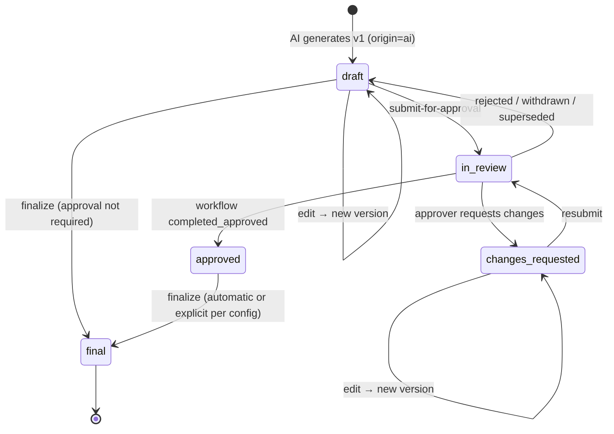

# Artifact Status and Approval Lifecycle

| Field | Value |
|---|---|
| Status | Accepted |
| Spec class | Implementation-ready |
| Version | 1.0.0 |
| Last Updated | 2026-09-28 |
| Owner | Artifacts domain + Workflow domain |
| Blueprint | BP §12, §12.1 ("AI Draft → Review → Changes Requested → Approved → Final → Exported") |

## Purpose

**Canonical** artifact status machine and its relation to Workflow Instances. Approval workflow configuration: [platform/collaboration/approval](../platform/collaboration/approval.md).

## Statuses

| Status | BP §12.1 term | Meaning | Editable |
|---|---|---|---|
| `draft` | AI Draft | Current version is a draft (AI-generated or human-edited) | Yes |
| `in_review` | Review | A workflow instance is active on the current version | No (default `lock`) |
| `changes_requested` | Changes Requested | An approver requested changes | Yes (edit → then resubmit) |
| `approved` | Approved | Workflow completed with approval | No |
| `final` | Final | Finalisation done: number allocated, version locked | No |
| — | Exported | **Derived:** `has_exports = true` when ≥ 1 successful export exists. Not a status, because exports happen from `draft` (preview) through `final` and multiple formats may coexist | n/a |

## Diagram

## Rules

1. **Workflow state ≠ Artifact status.** Workflow instances track the process (`active`, `completed_approved`, …); the Workflow context updates Artifact status only via `SubjectStatusPort` at defined outcomes ([workflow-architecture](../architecture/workflow-architecture.md)).
2. Submission requires no open **blocking** review items (`ARTIFACT_UNRESOLVED_REVIEW_ITEMS`) and entitlement `workflow.approval`.
3. Edit during review: default `lock` (409 `ARTIFACT_LOCKED`); workflow definitions may set `on_edit_during_review: supersede`, in which case an edit creates a new version, supersedes the instance and returns the artifact to `draft`.
4. **Finalisation** (from `approved`, or from `draft` if the module requirement is `optional`/`configurable` and the organization does not require approval): allocates the document number transactionally ([numbering-sequences](numbering-sequences.md)), sets `final_version_id`, records signatures, emits `artifact.finalized`, may create Action Items (`createsActionItems.trigger = final`).
5. Final is terminal in v1. Amendments: [OD-020](../governance/open-decisions.md#od-020) (recommended: new linked Artifact).
6. AI regeneration never modifies an approved/final version; it can only create a new draft version when the artifact is in `draft`/`changes_requested`.

## Users See "Draft until confirmed"

The editor shows a Draft banner for all non-final statuses (BP §16.2).
