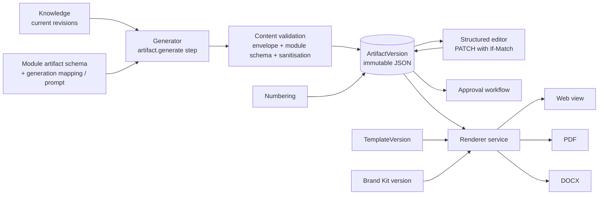

# Artifact Engine

| Field | Value |
|---|---|
| Status | Accepted |
| Spec class | Implementation-ready |
| Version | 1.0.0 |
| Last Updated | 2026-09-28 |
| Owner | Artifacts domain |
| Blueprint | BP §0.1, §12, [ADR-016](../governance/adr/ADR-016-structured-artifact-content.md), G10 |

## Purpose

Produce, version, edit, approve and render structured artifacts from Knowledge — generically for all modules.

## Components

## Generation Modes

| Mode | Description | Example |
|---|---|---|
| Deterministic mapping | Module declares JSONata-like mapping from Knowledge to artifact body; no AI | Action list, open-items list |
| AI-composed | `ai.generate` step produces body under output schema, citing knowledge IDs; validated; prose fields may cite evidence | Executive summary, formal letter wording |
| Hybrid | Deterministic structure + AI prose for specific fields | Minutes (structure from Knowledge, summary paragraph by AI) |

In every mode the body must validate against the module artifact schema, and every bound field records `bindings` to Knowledge ([structured-content](structured-content.md)).

## Documents

[artifact-domain](artifact-domain.md) · [artifact-versioning](artifact-versioning.md) · [structured-content](structured-content.md) · [editor-contract](editor-contract.md) · [template-engine](template-engine.md) · [brand-kit](brand-kit.md) · [numbering-sequences](numbering-sequences.md) · [rendering](rendering.md) · [pdf-export](pdf-export.md) · [docx-export](docx-export.md) · [approval-lifecycle](approval-lifecycle.md) · [evidence-display](evidence-display.md)
