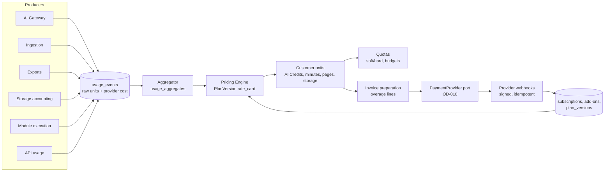

# Billing Architecture

| Field | Value |
|---|---|
| Status | Accepted |
| Spec class | Implementation-ready (payment provider Open) |
| Version | 1.0.0 |
| Last Updated | 2026-09-28 |
| Owner | Commerce domain + Founder |
| Blueprint | BP §5, §22, §22.1, EPIC-03, EPIC-22, G12 |

## Model

```text
Platform Subscription + Seats + Included Usage + Module Entitlements/Add-ons + Overage   (BDR-001)
```

## Components



## Separation of Concerns (BP §22)

Every consumption first creates an exact **UsageEvent** (raw units). The **Pricing Engine** later converts raw usage into billable units. Pricing changes never modify processing workers.

## Payment Provider Port

`CreateCustomer`, `CreateSubscription`, `UpdateSubscription`, `ReportUsage` (if metered billing at provider) or `CreateInvoiceItem`, `CancelSubscription`, webhook handler. Provider per region ([OD-010](../governance/open-decisions.md#od-010)); manual invoicing adapter for Enterprise.

## Documents

[pricing-model](pricing-model.md) · [plan-model](plan-model.md) · [subscription-model](subscription-model.md) · [usage-metering](usage-metering.md) · [usage-event-catalog](usage-event-catalog.md) · [ai-credit-model](ai-credit-model.md) · [quotas](quotas.md) · [overage](overage.md) · [module-pricing](module-pricing.md) · [marketplace-economics](marketplace-economics.md) · [unit-economics](unit-economics.md) · [cost-attribution](cost-attribution.md) · [billing-failure-cases](billing-failure-cases.md)
