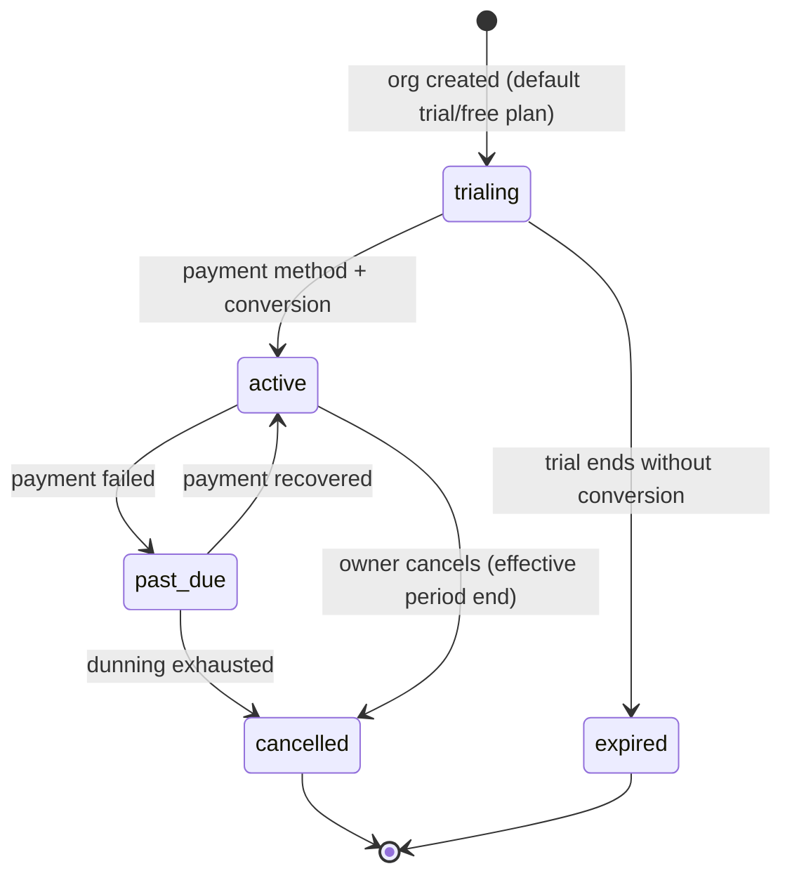

# Subscription Model

| Field | Value |
|---|---|
| Status | Accepted |
| Spec class | Implementation-ready |
| Version | 1.0.0 |
| Last Updated | 2026-09-28 |
| Owner | Commerce domain |
| Blueprint | BP §5, §7.3 (subscriptions), App. E (partial unique active subscription) |

## States

## Rules

- One active (`trialing|active|past_due`) subscription per organization.
- Seats: `seats` purchased ≥ active memberships counted; adding members beyond seats prompts seat purchase (or blocks per plan).
- Add-ons (`subscription_addons`) grant entitlements via `organization_entitlements (source=addon)`.
- Plan change: upgrade immediate (proration by provider), downgrade at period end; entitlement effects applied via `subscription.changed` → entitlement recompute.
- `past_due` grace period (for example 14 days, provisional) keeps service; after that → `BILLING_PAYMENT_REQUIRED` for new jobs; data remains readable/exportable.
- Expired/cancelled orgs: read-only access and export for a retention grace period, then organization deletion workflow per policy.
