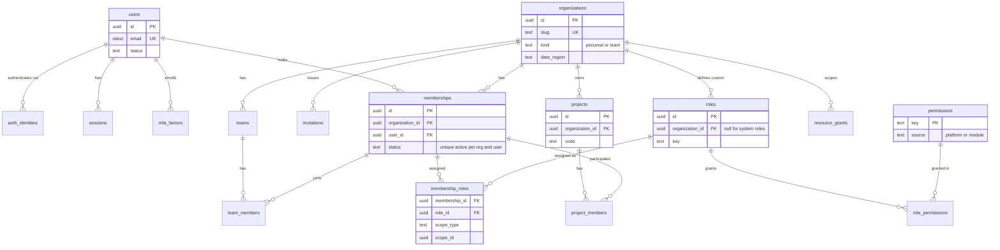
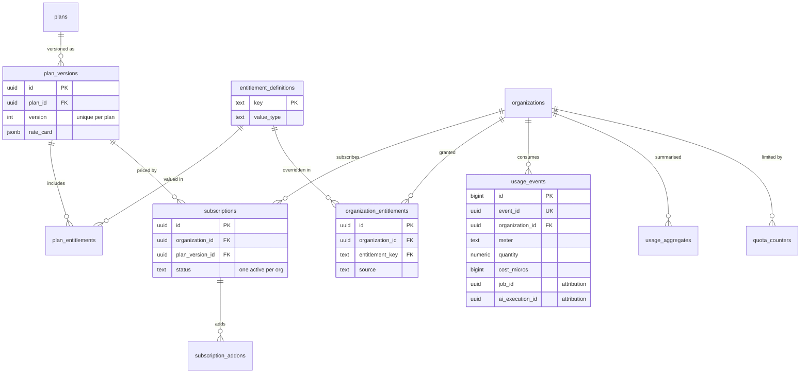
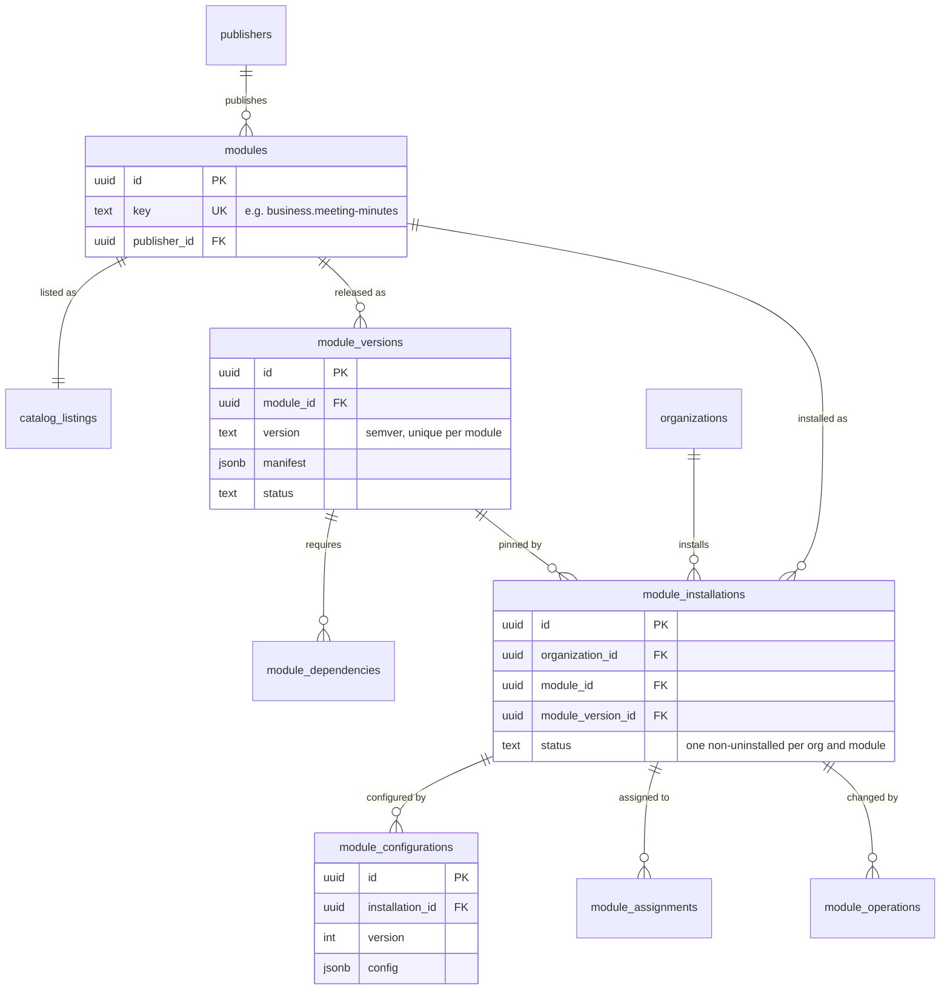
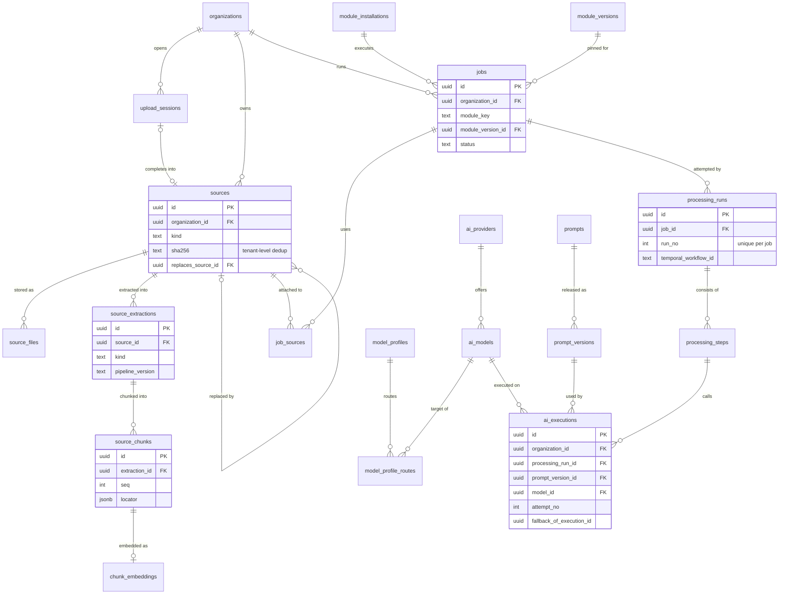
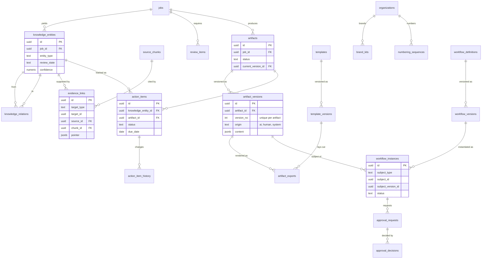
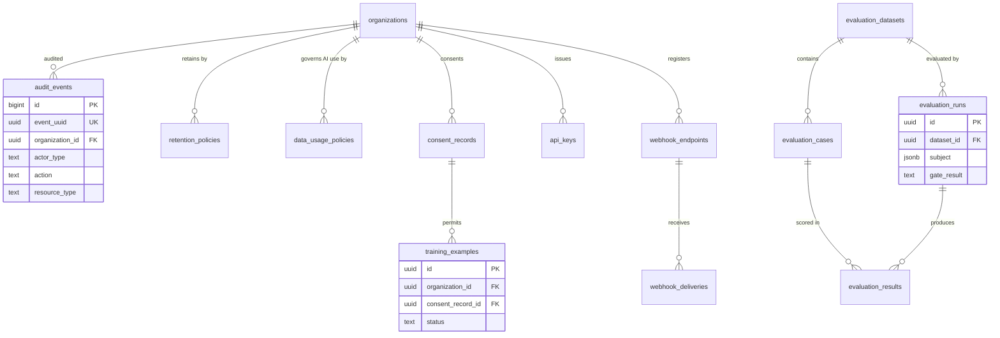

# Entity-Relationship Diagrams

| Field | Value |
|---|---|
| Status | Accepted |
| Spec class | Implementation-ready (logical) |
| Version | 1.0.0 |
| Last Updated | 2026-09-28 |
| Owner | Tech Lead (Go) / Data |
| Blueprint | BP §7.1, §7.3, App. E |

## Purpose

Logical ERD split by area. Diagrams show keys and relationships only; column-level details, tenancy, immutability and retention are in the [entity-catalog](entity-catalog.md). Every tenant table also carries `organization_id` (shown as `organization_id` FK where it is the primary relationship; always present per BP §7.2).

Cross-context relationships are **ID references** (no cross-context ORM navigation); foreign-key constraints are still declared in the database for integrity while the monolith shares one database ([future-service-extraction](../architecture/future-service-extraction.md)).

## 1. Identity, Organizations, Access, Projects

## 2. Commerce

## 3. Module Platform and Marketplace

## 4. Sources, Jobs, Processing, AI

## 5. Knowledge, Artifacts, Templates, Workflow, Actions

## 6. Governance, Evaluation, Integration

