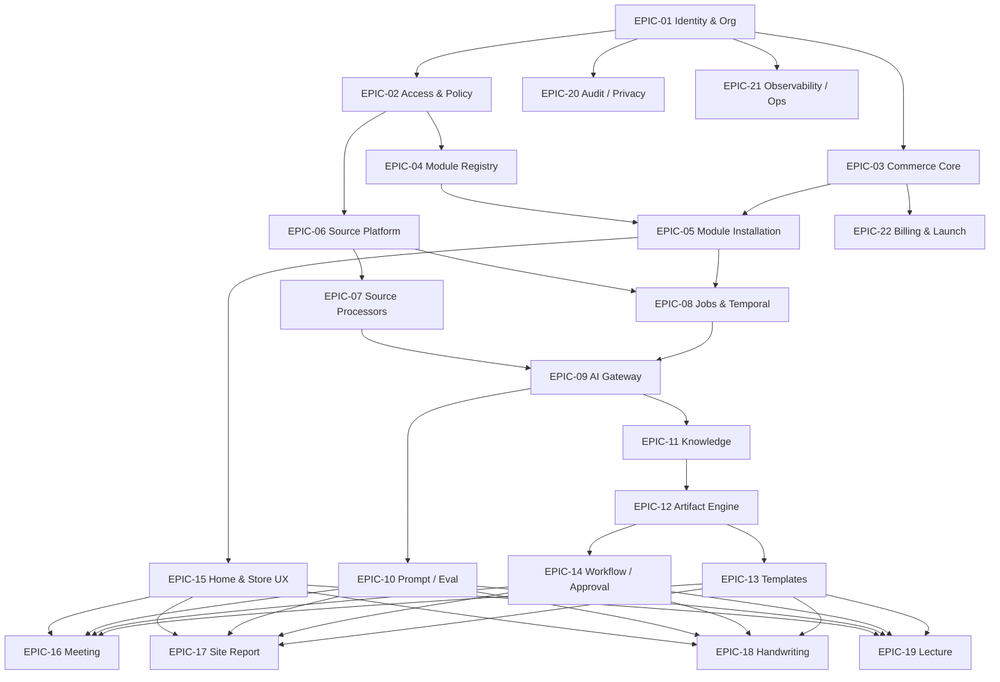

# Dependency Map

| Field | Value |
|---|---|
| Status | Accepted |
| Spec class | Baseline |
| Version | 1.0.0 |
| Last Updated | 2026-09-28 |
| Owner | Tech Lead |
| Blueprint | BP §24, §25 |

## Epic Dependencies

EPIC-20 (audit) and EPIC-21 (observability) start in Sprint 0 as foundations and grow with every epic. EPIC-17 additionally depends on PWA offline capabilities.

## External/Decision Dependencies

| Dependency | Needed by | OD |
|---|---|---|
| Router, SQL library, migration tool, monorepo tooling | Sprint 0 | Closed: ADR-023, ADR-024, ADR-025, ADR-026 (+ ADR-027 Go 1.27.x) |
| Identity provider | G4 | OD-004 |
| Secret manager | G4 | OD-013 |
| Object storage (prod), AV engine | G6 | OD-006, OD-011 |
| Workflow DSL | G5/G7 | OD-018 |
| ASR/LLM providers | G8 | OD-015, OD-016 |
| Renderers, UI kit/editor, template format | G10 | OD-008, OD-009, OD-014, OD-038 |
| Payment provider, pricing | G12 | OD-010, OD-021 |
| Hosting, runtime platform | G13 | OD-005, OD-029 |
