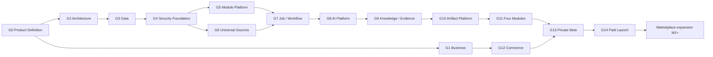

# Execution Roadmap and Gates

| Field | Value |
|---|---|
| Status | Accepted |
| Spec class | Baseline (calendar estimates Provisional) |
| Version | 1.0.0 |
| Last Updated | 2026-09-28 |
| Owner | Technical Leadership + Product |
| Blueprint | BP §24, §24.1 |

## Principle (BP §24)

Development is **gate-based**, not date-based. Each gate stabilises an architectural contract with testable exit criteria. Calendar estimates are for capacity planning only; exit is controlled by quality gates.

## Gate Overview

## Gates (Blueprint G0–G14)

| Gate | Entry criteria | Deliverables (BP §24) | Exit criteria (BP §24 + refinements) | Dependencies | Key risks | Validation |
|---|---|---|---|---|---|---|
| **G0 Product Definition** | Blueprint approved | Vocabulary, scope, personas, module IDs, success metrics | Core PRD and four Module PRDs approved (this `/docs` product + module specs accepted) | — | Scope creep | Product review sign-off |
| **G1 Business** | G0 | Pricing hypothesis, metering, plan/entitlement model | Unit Economics model v0 | G0 | Wrong cost assumptions | Model reviewed with provider price lists |
| **G2 Architecture** | G0 | Bounded contexts, ADRs, repo, runtime | Architecture review passed | G0 | Premature complexity | Architecture review record |
| **G3 Data** | G2 | ERD, tenancy, versioning, retention | Migration baseline + schema review | G2 | Missing tenant keys | Migration tests, schema review |
| **G4 Security Foundation** | G3 | Auth, organization, RLS, secrets, baseline audit | Security checklist passed (Alpha security gate) | G3, [OD-004](../governance/open-decisions.md#od-004), [OD-013](../governance/open-decisions.md#od-013) | RLS gaps | RLS/BOLA tests green; threat model accepted |
| **G5 Module Platform** | G4 | Registry/store/install/disable/config/version | Four modules install as packages | G4 | Manifest too narrow | Module install matrix tests |
| **G6 Universal Sources** | G4 | Upload/storage/extraction/chunking | All target input types can be ingested | G4, [OD-006](../governance/open-decisions.md#od-006), [OD-011](../governance/open-decisions.md#od-011) | Parser security, Persian OCR/ASR | Ingestion fixtures per kind |
| **G7 Job / Workflow** | G5, G6 | Temporal, progress, retry, idempotency | Workflow failure/recovery tests pass | G5, G6, [OD-018](../governance/open-decisions.md#od-018) | Non-determinism | Workflow + chaos tests |
| **G8 AI Platform** | G7 | Gateway/router/prompt/model/evals | Provider swap requires no Module change | G7, [OD-015](../governance/open-decisions.md#od-015), [OD-016](../governance/open-decisions.md#od-016), [OD-033](../governance/open-decisions.md#od-033) | Persian quality, cost | Swap test; eval runs |
| **G9 Knowledge / Evidence** | G8 | Entities/relations/evidence/review | End-to-end fact traceability | G8 | Evidence precision | Evidence alignment metrics |
| **G10 Artifact Platform** | G9 | Editor/version/template/export/approval | Official versioned PDF/DOCX output | G9, [OD-008](../governance/open-decisions.md#od-008), [OD-009](../governance/open-decisions.md#od-009), [OD-014](../governance/open-decisions.md#od-014) | DOCX/PDF fidelity | Golden export tests |
| **G11 Four Modules** | G10 | Four complete modules | Module-specific acceptance tests pass | G10 | Persian AI quality | Module acceptance criteria + golden suites |
| **G12 Commerce** | G1, G4 | Billing/quota/usage/plans | Paid subscription sandbox works | G1, [OD-010](../governance/open-decisions.md#od-010), [OD-021](../governance/open-decisions.md#od-021) | Regional payments | Billing E2E in sandbox |
| **G13 Private Beta** | G11, G12 | Observability/support/feedback/security | Pilot organizations active | G11, G12, [OD-005](../governance/open-decisions.md#od-005), [OD-029](../governance/open-decisions.md#od-029) | Operational readiness | Private Beta security gate; runbooks exercised |
| **G14 Paid Launch** | G13 | Hardening, docs, backups, penetration test | Commercial readiness approved | G13 | Pen-test findings | Paid Launch security gate; DR test |
| **Marketplace expansion** | G14 + demand | M1–M4 | Per stage ([marketplace-roadmap](../marketplace/marketplace-roadmap.md)) | G14 | Ecosystem security | Stage reviews |

## Suggested Phases (BP §24.1, capacity estimates for a 3–5 person team)

| Phase | Gates | Rough capacity |
|---|---|---|
| Foundation | G0–G4 | 4–6 weeks |
| Platform Core | G5–G10 | 8–12 weeks |
| Modules v1 | G11 | 8–12 weeks (controlled parallel development) |
| Commercial Beta | G12–G13 | 4–6 weeks |
| Hardening / Launch | G14 | 3–5 weeks |

Estimates are not commitments; Persian AI quality and module evaluation may change the calendar.

## Mapping from the Documentation Brief's Gate List

| Brief gate | Blueprint gate(s) |
|---|---|
| G0 Product Definition | G0 |
| G1 Business / Metering Model | G1 |
| G2 Architecture | G2 |
| G3 Data | G3 |
| G4 Platform Core | G4 Security Foundation (+ platform core spans G4–G10) |
| G5 Module System | G5 |
| G6 Universal Ingestion | G6 |
| G7 AI Gateway / Evaluation | G8 (G7 is Job/Workflow in Blueprint) |
| G8 Knowledge / Evidence | G9 |
| G9 Artifact Engine | G10 |
| G10 Workflow / Approval | G7 (durable workflow) + G10 (approval) |
| G11 Four Launch Modules | G11 |
| G12 Commercial/Billing readiness | G12 |
| G13 Beta / Security / Observability | G13 + G14 |
| Future Marketplace expansion | Marketplace M1–M4 |

Sprint 0 and Sprint 1 execute the G2–G4 foundations and a thin slice through G5–G10 ([sprint-0](sprint-0.md), [sprint-1](sprint-1.md)).
