# Sprint 1 — Platform Vertical Slice

| Field | Value |
|---|---|
| Status | Accepted |
| Spec class | Implementation-ready |
| Version | 1.0.0 |
| Last Updated | 2026-09-28 |
| Owner | Tech Lead + Frontend Lead |
| Blueprint | BP §29.3 (readiness criterion), App. F (Sprint 1) |

## Goal

Prove the generic platform path end to end with the Hello Module:

```mermaid
flowchart LR
  U[User] --> O[Organization] --> M[Installed Hello Module<br/>from Store]
  M --> J[Create Job] --> S[Upload Source<br/>text/image]
  S --> P[Process Source<br/>Temporal + mock processor]
  P --> AI[AI Gateway<br/>mock provider]
  AI --> K[Structured Knowledge<br/>1 entity + evidence]
  K --> A[Artifact v1<br/>+ version record]
  A --> R[Review item resolve]
  R --> E[Export prototype]
```

## Deliverables (BP App. F) and Acceptance

| # | Area | Deliverable | Acceptance |
|---|---|---|---|
| S1-01 | Minimal Module Store | Hello Module appears in catalog from its manifest; install/enable/disable works; permissions registered | `GET /v1/store/modules` lists it; install operation succeeds; disable blocks new jobs (`MODULE_DISABLED`) |
| S1-02 | Upload | Direct upload of text/image sample; Source record; malware scan stub (EICAR test path) | Source `available`; EICAR → `quarantined` |
| S1-03 | Job | Draft → attach source → ready → submit (idempotent) | Duplicate submit returns same result; ProcessingRun #1 created |
| S1-04 | Temporal | JobProcessingWorkflow (generic interpreter subset) with mock processor | Worker kill mid-run → completes; cancel works |
| S1-05 | AI Gateway (mock) | Capability request → mock provider → schema validation → AIExecution + UsageEvent | Malformed-JSON scenario triggers repair then fallback (mock routes) with separate AIExecutions |
| S1-06 | Knowledge | One entity + evidence (text span or bbox) + review item when low confidence | Evidence resolves to source location via API |
| S1-07 | Artifact | Structured artifact v1 (envelope-validated) + version record; edit with If-Match creates v2 | 412 on stale ETag; versions list shows AI then Human |
| S1-08 | Export prototype | Simple PDF (or HTML-to-PDF prototype) of artifact | File downloadable via presigned URL |
| S1-09 | Frontend | Home card from API; create job; composer upload; processing timeline via SSE; artifact read/edit view | Card not hard-coded; SSE reconnect works; RTL layout |
| S1-10 | Governance | Permission + entitlement checks; audit events; usage events | Viewer cannot create job (403); org without `module.platform.hello` gets 402; audit shows install/job/artifact events; usage shows mock tokens + module.execution |
| S1-11 | Tenant isolation | RLS on all new tables; BOLA tests for new endpoints | Cross-tenant suite green in CI |
| S1-12 | E2E | Install Module → Create → Process → Artifact (Playwright) | Green in CI on every PR to main |

## Definition of Done (exact)

Sprint 1 is done when **all** hold:

1. A clean organization installs the Hello Module from the Store **without any Core code change referencing it** (grep check: no `platform.hello` literal in `internal/`).
2. A member creates a Job, uploads a Source, submits, and receives a structured Artifact v1 produced via Temporal + AI Gateway (mock) + Knowledge + Evidence.
3. Permission, Entitlement, Audit and Usage are exercised end to end and verified by automated tests.
4. Worker crash and cancel scenarios pass automated tests.
5. Tenant-isolation tests (RLS + BOLA) for all Sprint 1 tables/endpoints pass in CI.
6. OpenAPI covers every implemented endpoint and contract tests pass.
7. One trace shows the full path with correlation IDs (API → workflow → AI execution → artifact).
8. E2E test S1-12 passes in CI.
9. Demo performed in staging-like environment (weekly E2E demo practice, BP §26.1).

This satisfies the Blueprint readiness criterion (BP §29.3): "a sample Hello Module can be installed from the Store, create a Job, accept a Source, execute a Workflow, produce a structured Artifact, and exercise Permission, Entitlement, Audit, and Usage end to end."
