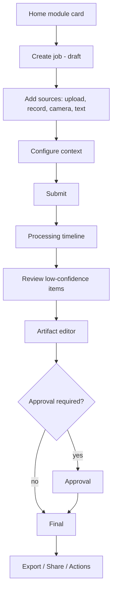

# Information Architecture

| Field | Value |
|---|---|
| Status | Accepted |
| Spec class | Implementation-ready |
| Version | 1.0.0 |
| Last Updated | 2026-09-28 |
| Owner | Product Design + Frontend |
| Blueprint | BP §20, App. A (Screen Inventory and User Flows) |

## Top-Level Structure (BP §20)

```text
Home
├── Create (module cards: Meeting Minutes, Site Report, Handwriting → Document, Lecture Summary, …)
├── Inbox / Sources
├── Jobs
├── Artifacts
├── Actions
├── Projects
├── Module Store
└── Organization / Settings
```

## Screen Inventory (BP App. A) → Routes

| Screen | Route | Scope |
|---|---|---|
| Authentication | `/login`, `/auth/verify`, `/auth/mfa` | Login, magic link, OAuth, MFA, sessions |
| Onboarding | `/onboarding` | Create personal/org workspace, name, locale, timezone, initial policy |
| Home / Create | `/` | Card view of installed modules, recent jobs, Quick Clerk |
| Module Store | `/store`, `/store/:category` | Discover, category, search, installed, updates |
| Module Detail | `/store/modules/:key` | Description, publisher, inputs, outputs, pricing/entitlement, install/enable |
| New Job | `/m/:moduleKey/new` | Module, metadata, project/context, sources |
| Source Composer | (panel within New Job / Inbox) | Record, camera, drag/drop, file picker, manual text, upload progress |
| Processing | `/jobs/:id` (processing state) | Stage timeline, progress, cancel, error/retry |
| Review Queue | `/review`, `/jobs/:id/review` | Low-confidence fields, evidence, confirm/edit/reject |
| Artifact Editor | `/artifacts/:id` | Structured sections, sources panel, AI/evidence panel |
| Export / Share | dialog on artifact | Template, PDF/DOCX, share link, version, approval status |
| Inbox / Sources | `/inbox` | Independent sources, processing status, reuse/create artifact |
| Jobs | `/jobs` | Filter by module/status/user/project; limited bulk actions |
| Artifacts | `/artifacts` | Final/draft, versions, search, tags |
| Actions | `/actions` | Action items, owner, deadline, status, source artifact |
| Projects | `/projects`, `/projects/:id` | Overview, team, jobs, artifacts, actions |
| Templates | `/settings/templates` | Brand kit, template versions, numbering |
| Organization / Members | `/settings/members`, `/settings/teams` | Invitations, memberships, teams, deactivate |
| Roles & Permissions | `/settings/roles` | Default/custom roles and permission matrix |
| Modules / Manage | `/settings/modules`, `/settings/modules/:key` | Enable/disable, team assignment, version, config |
| Billing & Usage | `/settings/billing` | Plan, seats, AI usage, storage, overage, invoices |
| AI Policy | `/settings/ai-policy` | Provider policy, training consent, retention, human-review defaults |
| Audit Log | `/settings/audit` | Filter by actor/action/resource/time; export (eligible plans) |
| Security | `/settings/security` | MFA, sessions, API keys, webhook secrets, SSO (Enterprise) |
| Integrations | `/settings/integrations` | Webhooks, API keys, future integrations |
| Approvals | `/approvals` | Pending approvals for me |

## Generic Artifact Creation Flow (App. A)



Module-specific flows: each module's `product-spec.md`.
