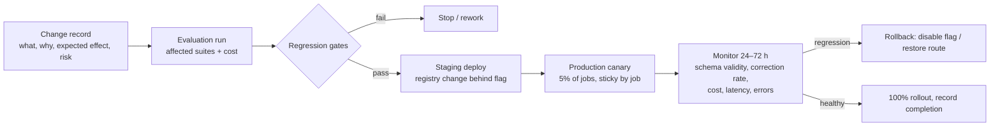

# Model Change Management

| Field | Value |
|---|---|
| Status | Accepted |
| Spec class | Implementation-ready |
| Version | 1.0.0 |
| Last Updated | 2026-09-28 |
| Owner | AI Engineer + Tech Lead |
| Blueprint | BP §16.1 |

## Rules (BP §16.1)

1. **No direct production model switch** without an evaluation and a change record.
2. Model, prompt and schema versions are stored in artifact provenance.
3. Large changes use feature flags / canary rollout.
4. Rollback paths are tested.
5. Provider outage, fallback policy and degraded mode are defined ([fallback-strategy](../ai/fallback-strategy.md)).
6. Quality regression **and** cost regression can both block a release.

## What Counts as a Model Change

Adding/removing/reordering profile routes; changing a route's model version; changing provider parameters that affect output (temperature, max tokens, language hints); changing a prompt version or output schema; changing an ingestion pipeline's AI profile.

## Procedure

## Change Record Fields

ID, date, owner, component (profile/prompt/schema/pipeline), from→to versions, evaluation run IDs, gate results, canary plan, rollback plan, approval (AI Engineer + Tech Lead; Product for user-visible behaviour changes).
