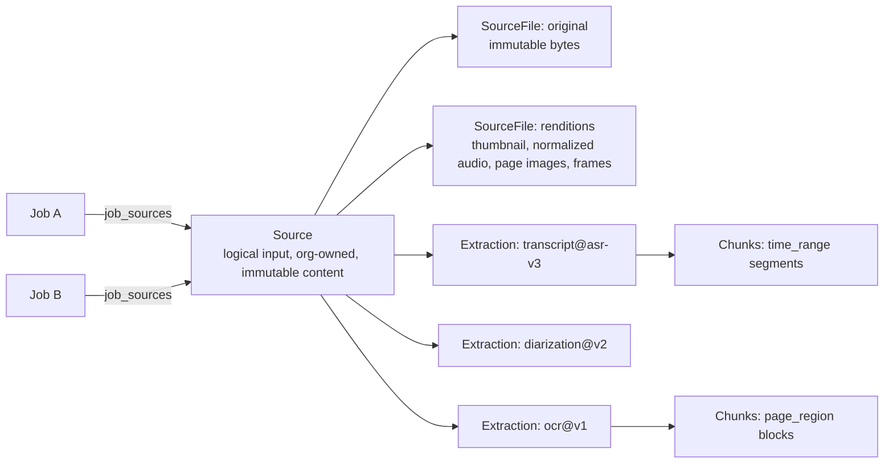

# Source Model

| Field | Value |
|---|---|
| Status | Accepted |
| Spec class | Implementation-ready |
| Version | 1.0.0 |
| Last Updated | 2026-09-28 |
| Owner | Sources domain |
| Blueprint | BP §7.2, §7.3, §9, §30.1, [PDR-004](../governance/pdr/PDR-004-source-reusability.md) |

## Purpose

Canonical definitions of Source, SourceFile, Extraction and Chunk. Columns: [entity-catalog](../data/entity-catalog.md#sources-owner-source). Lifecycle: [source-lifecycle](../architecture/source-lifecycle.md).

## Concepts

| Concept | Definition | Mutability |
|---|---|---|
| **Source** | A tenant-owned logical input (one uploaded file, one recorded clip, one text note). Independent of modules and jobs. | Content immutable; metadata (title, project) editable |
| **SourceFile** | A physical object in object storage: exactly one `original`, zero or more `rendition`s. | Immutable |
| **Extraction** | Output of one pipeline kind at one pipeline version over one Source. | Immutable payload; status transitions only |
| **Chunk** | Addressable segment of an extraction (text span, time range, page region, table, slide, frame) with a `locator`. | Immutable |
| **Normalized Content** | The `normalized_content` extraction: a source-type-independent structure used by modules ([normalization](normalization.md)). | Immutable per version |

## Source Kinds

`audio`, `video`, `image`, `document` (PDF, DOCX, scanned PDF), `spreadsheet`, `presentation`, `text`. Handwriting is not a kind: it is an image/document whose extraction includes `handwriting_ocr`.

## Replacement and Versioning

- Replacing a file creates a **new Source** with `replaces_source_id` referencing the old one. Existing Jobs, Knowledge and Evidence keep pointing to the old Source (evidence remains valid).
- New pipeline versions create **new Extraction rows**; old ones become `superseded` but remain until no evidence references them or retention removes them.

## Metadata

`captured_at`, `capture_location` (GPS from device, optional and permission-gated), `language_hint`, `project_id`, `created_by`, `client_ref` (offline ID), `retention_category` (derived from kind). EXIF data is extracted into metadata and stripped from renditions shared externally.

## Access

Sources are visible according to [resource-policies](../platform/access/resource-policies.md) (creator, project/team scope, explicit grants). Attaching a Source to a Job requires `sources.view` on it.

## Related Documents

[upload-flow](upload-flow.md), [source-processing](source-processing.md), [deduplication](deduplication.md), [extraction-cache](extraction-cache.md), [chunking](chunking.md)
