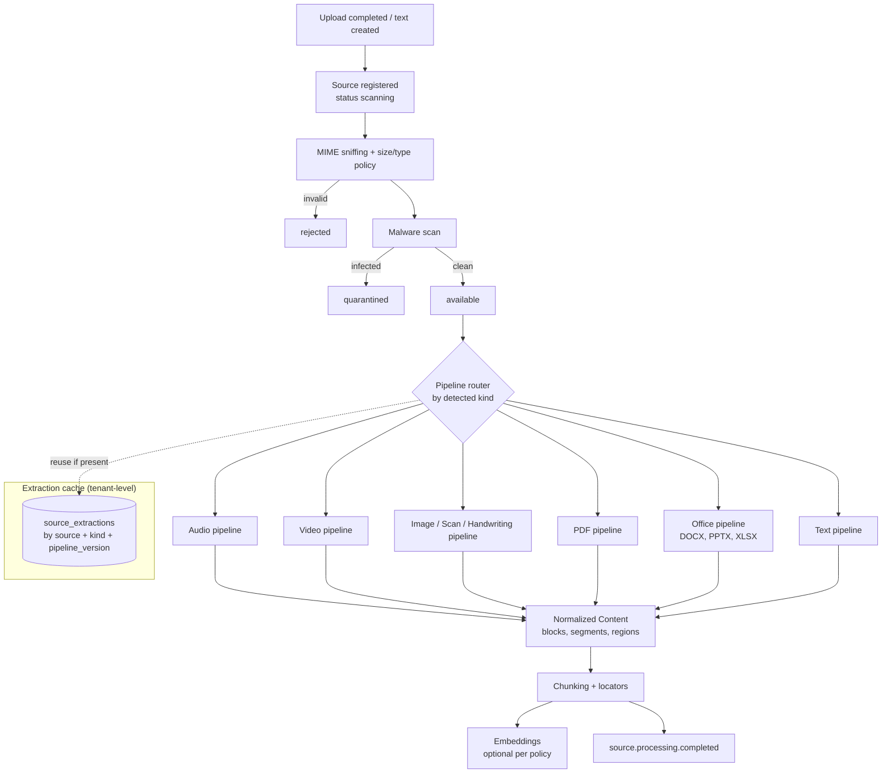

# Universal Ingestion

| Field | Value |
|---|---|
| Status | Accepted |
| Spec class | Implementation-ready |
| Version | 1.0.0 |
| Last Updated | 2026-09-28 |
| Owner | Sources domain + AI Engineer |
| Blueprint | BP §0.1, §1.1 (Source-first), §9, §9.1, §22.1 (dedup/caching), G6 |

## Purpose

A reusable ingestion system that turns any Source into **Normalized Content** and **Chunks**, driven by **source type, never by module**. Modules consume normalized sources; they never implement OCR/transcription stacks.

## Architecture

## Baseline Pipelines (BP §9)

| Source type | Baseline pipeline | Extraction kinds produced | Doc |
|---|---|---|---|
| Audio | validation → normalise → transcription → diarization → timestamps → language detection | `metadata`, `normalized_audio`, `transcript`, `diarization`, `language` | [audio-processing](audio-processing.md) |
| Video | metadata → audio extraction → transcription → frame sampling → visual analysis | `metadata`, `normalized_audio`, `transcript`, `frames`, `vision_caption` | [video-processing](video-processing.md) |
| Image / Scan | vision → OCR / handwriting → layout → bounding boxes → scene understanding | `metadata`, `ocr`, `handwriting_ocr`, `layout`, `vision_caption` | [image-processing](image-processing.md), [handwriting-processing](handwriting-processing.md) |
| PDF | text layer → layout → table and image extraction → page references | `text`, `layout`, `tables`, (`ocr` for scanned pages) | [document-processing](document-processing.md) |
| DOCX / PPTX / XLSX | native parse → text/table/image extraction → structure | `text`, `tables`, `slides`, `layout` | [document-processing](document-processing.md), [slide-processing](slide-processing.md), [spreadsheet-processing](spreadsheet-processing.md) |
| Text / Markdown | normalisation → language detection → chunking | `text`, `language` | [normalization](normalization.md) |

## Two Triggers

1. **Baseline ingestion at upload** (source-level, reusable): cheap and universally useful kinds run immediately (metadata, text layer, thumbnails, language). Expensive AI kinds (transcription, handwriting OCR, vision captioning) run at upload **only if** the organization's policy enables eager processing or the Source is uploaded into a Job slot that requires them.
2. **On-demand at Job processing:** the module workflow step `ingest.require` requests the extraction kinds declared by its input slots; the Sources context runs missing kinds or reuses cached ones.

This honours BP §8.1 (upload does not start the Job) and BP §22.1 (dedup and reuse of Source processing).

## Contracts

- Facade: `Sources.EnsureExtractions(ctx, tc, sourceIDs, kinds, options) → handle` and `Sources.AwaitExtractions(...)` (Temporal child workflow).
- Every extraction is versioned by `pipeline_key@pipeline_version`; results are immutable.
- Every AI call within ingestion goes through the AI Gateway (capability profiles), producing AIExecutions and Usage Events attributed to the Source (and Job when triggered by one).

## Failure Handling

Per-kind failure does not fail the Source entirely: status `partially_processed`, with `error_code` per extraction. Job steps decide whether a missing kind is fatal (required) or tolerable (optional).

## Security

All parsing is sandboxed (no network, resource limits); uploaded content is untrusted ([upload-security](../security/upload-security.md)). Text extracted from documents is treated as data, never as instructions ([prompt-injection](../security/prompt-injection.md)).

## Related Documents

[source-model](source-model.md), [upload-flow](upload-flow.md), [source-processing](source-processing.md), [extraction-cache](extraction-cache.md), [chunking](chunking.md)
