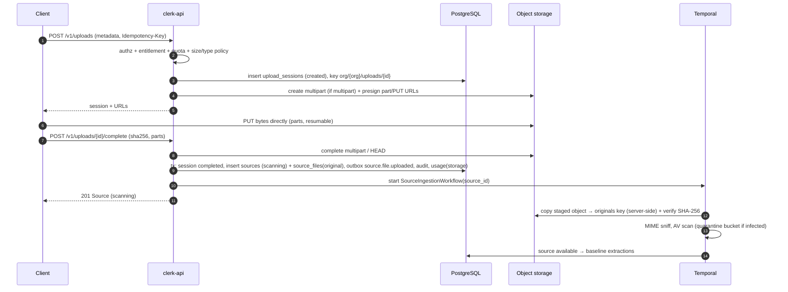
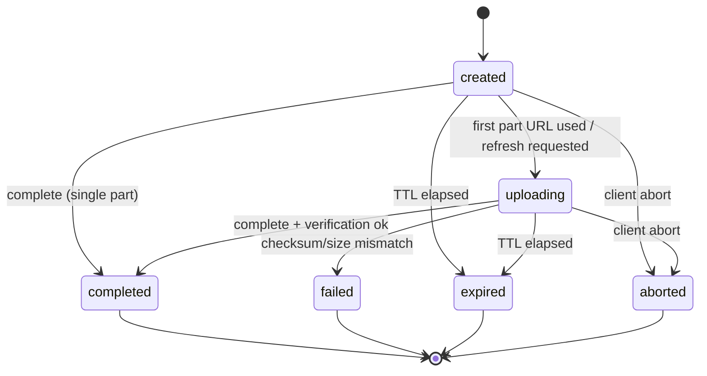

# Upload Flow

| Field | Value |
|---|---|
| Status | Accepted |
| Spec class | Implementation-ready |
| Version | 1.0.0 |
| Last Updated | 2026-09-28 |
| Owner | Sources domain |
| Blueprint | BP §8, §9.1, §14.2, [ADR-005](../governance/adr/ADR-005-direct-object-storage-upload.md) |

## Purpose

Canonical upload session lifecycle. HTTP contract: [api/uploads](../api/uploads.md).

## End-to-End Flow

## Upload Session States

## Capabilities

| Capability | Design |
|---|---|
| Multipart | S3 multipart; part size ≥ 5 MB; URLs per part |
| Resume | `GET /v1/uploads/{id}?refresh_parts=true` lists completed parts (via `ListParts`) and fresh URLs for the rest |
| Checksums | Client SHA-256 (whole file) mandatory at completion; per-part checksums where the provider supports them; server verifies whole-file hash asynchronously when the provider cannot |
| MIME validation | Declared type checked at session creation; **sniffed** type decides ([mime-validation](mime-validation.md)) |
| Max size | `upload.max_bytes` entitlement ∩ module slot limits ∩ platform ceiling |
| Malware scanning | Before any processing ([malware-scanning](malware-scanning.md)) |
| Deduplication | Tenant-level SHA-256 ([deduplication](deduplication.md)) |
| Derived assets | Renditions stored separately from original ([object-storage-layout](../data/object-storage-layout.md)) |
| Upload expiration | 24 h session TTL; bucket lifecycle aborts incomplete multipart after 7 d |
| Failed uploads | Session `failed` with reason; client may start a new session; staged object deleted |

## Staging vs Original Key

Bytes land under `org/{org}/uploads/{session}/…`. After verification the ingestion workflow server-side copies to the immutable `org/{org}/sources/{source}/original/{file}` key and deletes the staging object. Presigned URLs therefore never grant write access to original keys.
