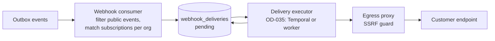

# Webhooks (Integration Domain)

| Field | Value |
|---|---|
| Status | Accepted |
| Spec class | Implementation-ready (executor Open) |
| Version | 1.0.0 |
| Last Updated | 2026-09-28 |
| Owner | Integrations domain |
| Blueprint | BP §8, §8.3 |

HTTP contract: [api/webhooks](../api/webhooks.md). Security: [api/webhook-security](../api/webhook-security.md), [security/webhook-security](../security/webhook-security.md).

## Internal Design

- One delivery row per (endpoint, event); attempts tracked; exponential backoff up to 24 h.
- Endpoint health: consecutive failure counter → `failing` → `disabled` with notification.
- Admin UI: deliveries list with status codes, retry button, secret rotation.
- Replay: admins can replay events from the retention window (7 days outbox; deliveries 30 days).
