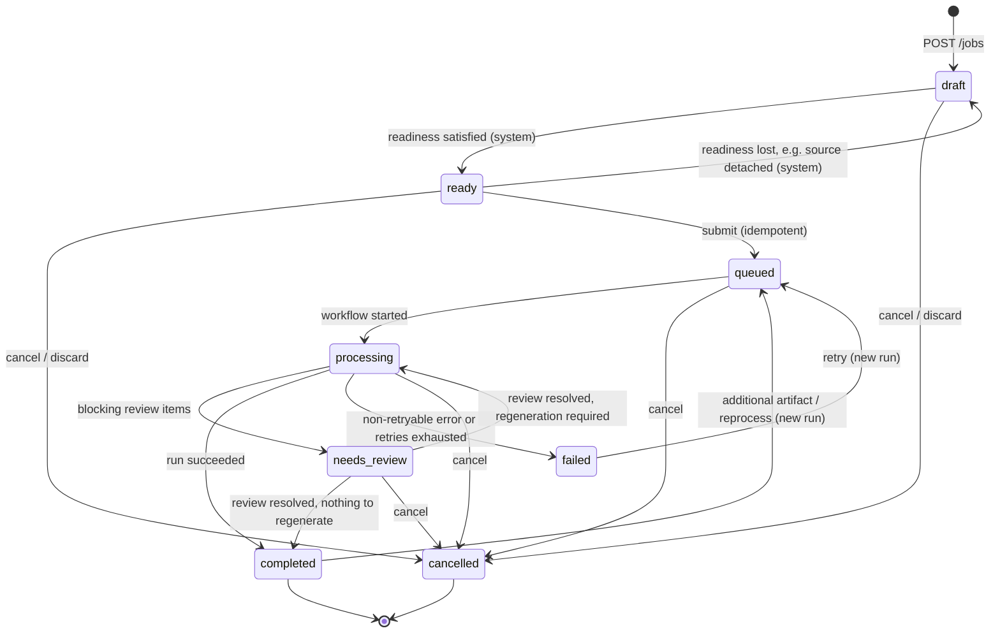

# Job State Machine

| Field | Value |
|---|---|
| Status | Accepted |
| Spec class | Implementation-ready |
| Version | 1.0.0 |
| Last Updated | 2026-09-28 |
| Owner | Jobs domain |
| Blueprint | BP §8.1, App. B |

## Purpose

**Canonical** definition of Job states and transitions. Every other document links here.

## States

| State | Meaning | Terminal |
|---|---|---|
| `draft` | Created; sources/input being assembled; readiness not satisfied | No |
| `ready` | Readiness rules satisfied; can be submitted | No |
| `queued` | Submitted; ProcessingRun created; waiting for workflow start or capacity | No |
| `processing` | Workflow executing | No |
| `needs_review` | Blocking review items must be resolved (human wait) | No |
| `completed` | Run succeeded; artifacts available | Yes* |
| `failed` | Run failed with a failure code | Yes* |
| `cancelled` | Cancelled by user/system | Yes |

\* `failed` can be retried; `completed` can re-enter `queued` only for an additional-artifact run or (if [OD-019](../governance/open-decisions.md#od-019) allows) a reprocess run. Each re-entry creates a new ProcessingRun.

## Diagram

## Transition Table

| From | To | Trigger | Actor | Guards | Side effects |
|---|---|---|---|---|---|
| draft | ready | attach source / update input | system | Manifest `inputs.readiness` satisfied; job input schema-valid; no attached source `quarantined`/`rejected`; source limits respected | — |
| ready | draft | detach / input change | system | Readiness no longer satisfied | — |
| draft, ready | cancelled | `POST /cancel` | user | `jobs.cancel` (own) or `jobs.manage` | audit |
| ready | queued | `POST /submit` | user/api | Installation `enabled`; entitlement `module.<key>`; permission `jobs.create` + `<key>.create`; resource policy; quota reservation (`jobs.concurrent`, estimated credits/minutes); idempotency key | Pin `module_version_id`, `workflow_version_id`, `configuration_id`; create ProcessingRun(trigger=submit); outbox `job.submitted`; audit; start Temporal workflow post-commit |
| queued | processing | workflow start activity | system | Run is current run | outbox `job.processing.started` |
| queued, processing, needs_review | cancelled | `POST /cancel` | user/system | as above | Temporal cancellation requested; run `cancelled` once workflow acknowledges; partial artifacts kept as drafts (flag `from_cancelled_run`); usage already incurred remains recorded |
| processing | needs_review | review gate step | system | ≥1 open blocking review item | outbox `job.review.required`; notification |
| needs_review | processing | review completion signal | system | All blocking items resolved; regeneration needed | Steps continue in same run |
| needs_review | completed | review completion signal | system | All blocking resolved; no regeneration | outbox `job.processing.completed` |
| processing | completed | final step | system | All required artifacts generated | outbox, notification, actions creation (if triggered at `generated`) |
| processing | failed | step failure | system | Non-retryable or retries exhausted | `failure_code`; outbox `job.failed`; quota reservation released minus consumption |
| failed | queued | `POST /retry` | user/api | `jobs.retry`; failure is retryable class; retry budget not exhausted (default 3 manual retries) | New run (trigger=retry), resumes from last successful step where safe ([resumability](resumability.md)) |
| completed | queued | `POST /jobs/{id}/artifacts` (additional artifact) or reprocess | user | Module declares `on_demand` artifact type / OD-019 policy | New run (trigger=additional_artifact / reprocess) |

## Invariants

- Adding a Source **never** implies submission unless the module manifest sets `inputs.autoSubmit: true` (default false) (BP §8.1).
- Pinned versions never change within a run; a new run may re-pin only on reprocess if policy allows (default: keep original pins).
- At most one active (non-terminal) ProcessingRun per Job.
- Every transition is a single DB transaction with outbox + audit; transitions are validated in the domain layer (illegal → `409 JOB_INVALID_TRANSITION`).

## Related Documents

[job-domain](job-domain.md), [processing-runs](processing-runs.md), [job-lifecycle](../architecture/job-lifecycle.md), [cancellation](cancellation.md), [retries](retries.md)
