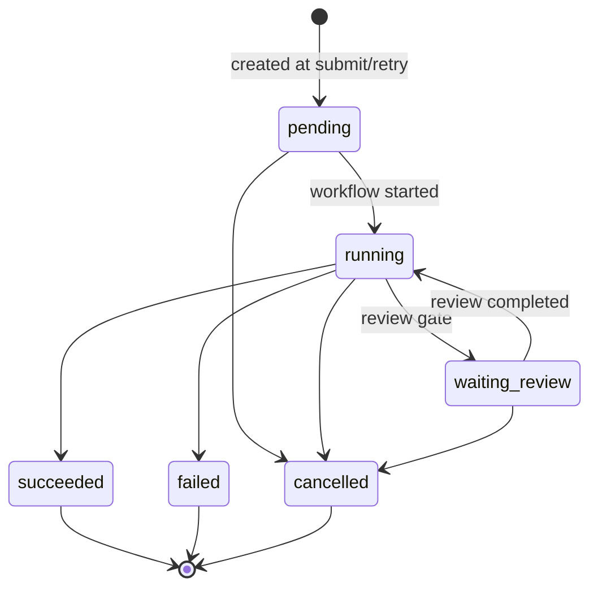

# Processing Runs

| Field | Value |
|---|---|
| Status | Accepted |
| Spec class | Implementation-ready |
| Version | 1.0.0 |
| Last Updated | 2026-09-28 |
| Owner | Processing domain |
| Blueprint | BP §7 (Processing: Run, Step, retry metadata), §7.3 |

## Definition (canonical)

A **ProcessingRun** is one execution attempt of a Job's processing. Job ↔ ProcessingRun is 1..n; at most one run is active. Distinction from Job: [glossary](../governance/glossary.md#disambiguation).

## Fields

`job_id`, `run_no` (1, 2, …), `trigger` (`submit`, `retry`, `reprocess`, `additional_artifact`), `status`, `module_version_id`, `workflow_definition_sha256`, `temporal_workflow_id`, `temporal_run_id`, `started_at`, `completed_at`, `failure_code`, `cost_micros_total` (rolled up from usage).

## Run States

Job status is derived from the current run: `pending→queued`, `running→processing`, `waiting_review→needs_review`, `succeeded→completed`, `failed→failed`, `cancelled→cancelled`.

## Why Runs

- Provenance: every Knowledge revision and AI ArtifactVersion references the run that produced it.
- Cost: cost per run and per job are both reportable.
- Debugging: runs map 1:1 to Temporal workflow executions.
