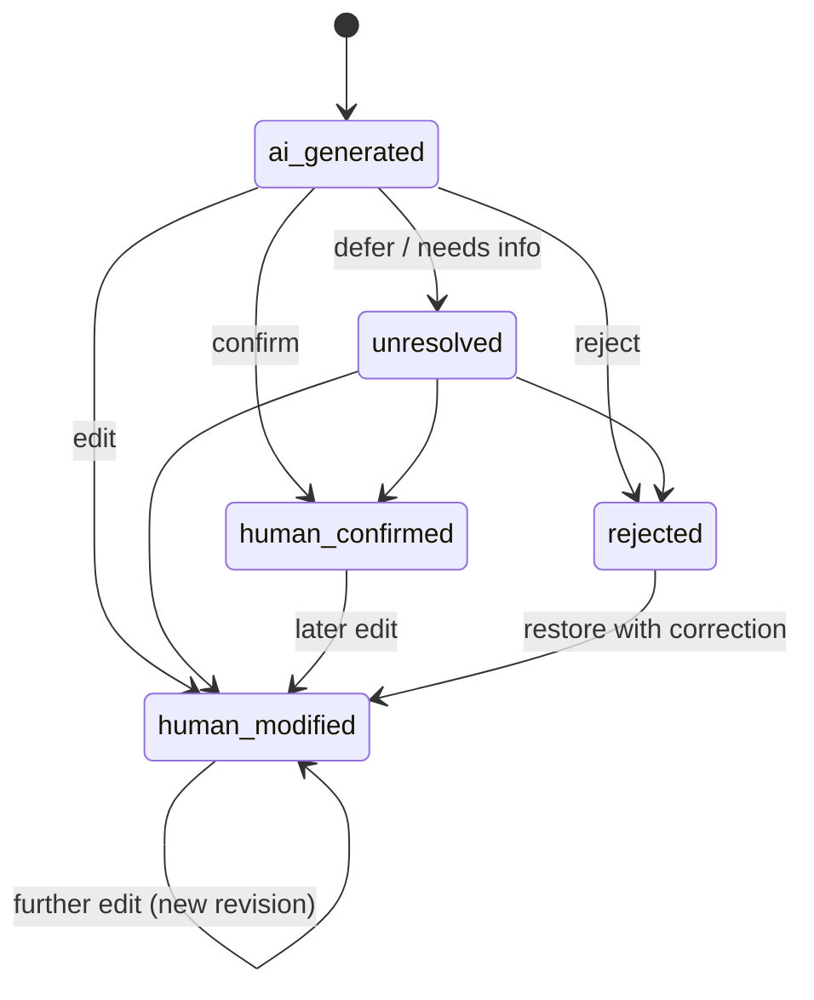

# Human Correction

| Field | Value |
|---|---|
| Status | Accepted |
| Spec class | Implementation-ready |
| Version | 1.0.0 |
| Last Updated | 2026-09-28 |
| Owner | Knowledge domain |
| Blueprint | BP §10.2, §11.3, App. D |

## Review States (canonical, BP §10.2)

| State | Meaning |
|---|---|
| `ai_generated` | Extracted by AI and not yet reviewed |
| `human_confirmed` | A person explicitly confirmed the same value |
| `human_modified` | A person corrected or changed the value |
| `rejected` | The extraction was wrong |
| `unresolved` | Requires further review |

Items created directly by humans start as `human_modified` with `origin=human`.

## Recording Corrections

- A modification creates a new entity **revision** (the AI revision is retained, [knowledge-versioning](knowledge-versioning.md)).
- The correction record stores: before value, after value, reviewer, time, review item, reason (optional), evidence changes.
- Artifact edits bound to Knowledge fields apply as corrections by default ([editor-contract](../artifacts/editor-contract.md)).

## Corrections Are Not Training Data by Default

Corrections feed **evaluation candidate** pipelines only if the organization's data usage policy allows; they never automatically become training data. Eligibility requires consent, review, anonymisation where needed, approval and versioning ([correction-data](../ai/training/correction-data.md), [training-data-policy](../privacy/training-data-policy.md)).

## Metrics

Human Correction Rate and Artifact Acceptance Rate derive from these states ([product-kpis](../product/product-kpis.md)).
