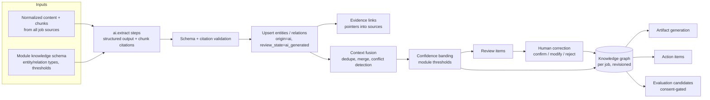

# Knowledge Layer

| Field | Value |
|---|---|
| Status | Accepted |
| Spec class | Implementation-ready |
| Version | 1.0.0 |
| Last Updated | 2026-09-28 |
| Owner | Knowledge domain |
| Blueprint | BP §1.1 (Knowledge-first, Evidence-first), §10, §10.1, §10.2, G9 |

## Purpose

The Knowledge Layer is Clerk's strategic differentiator (BP §10): a structured, evidence-backed, human-correctable representation of what the Sources say. **An Artifact is a view of Knowledge, not the raw output of a prompt.** This enables reuse (several artifacts from the same Knowledge), consistency, traceability and future training data.

## Architecture

## Core Concepts

| Concept | Canonical doc |
|---|---|
| Entity (typed node; base types + module subtypes) | [entity-model](entity-model.md) |
| Relation (typed edge) | [relation-model](relation-model.md) |
| Evidence (pointer to source location) | [evidence-model](evidence-model.md) |
| Confidence (raw score + bands + calibration) | [confidence-model](confidence-model.md) |
| Provenance (which run, prompt, model produced it) | [provenance](provenance.md) |
| Human correction states | [human-correction](human-correction.md) |
| Context fusion (multi-source merge) | [context-fusion](context-fusion.md) |
| Canonicalization | [entity-model](entity-model.md#canonicalization) |
| Retrieval | [retrieval](retrieval.md), [embeddings](embeddings.md) |
| Versioning/revisions | [knowledge-versioning](knowledge-versioning.md) |

## Scope of a Knowledge Graph

v1: **per Job**. Cross-job links exist only where a module declares them and scope is explicit (Site Report repeat inspection links observations/issues across visits within a project via `REINSPECTS`). Organization-wide knowledge graph/search is Future ([v1-scope](../product/v1-scope.md)).

## Extensibility Without Core Changes

Modules register entity **subtypes** (`meeting.action` extends base `action`) and relation types in the manifest, with JSON Schemas for attributes. Core tables are generic (`knowledge_entities.attributes JSONB` + `schema_ref`); no new tables per module (BP §10.1).

## Invariants

- Knowledge items are created only through validated AI output, human input, or deterministic system rules; never from raw unvalidated text.
- Every AI-originated item references its AIExecution and ProcessingRun.
- Evidence-required fields without valid evidence produce Review Items.
- Rejected items remain stored (for evaluation) but are excluded from artifacts.

## API

`GET /v1/jobs/{id}/knowledge`, `GET /v1/jobs/{id}/review-items`, `POST /v1/review-items/{id}/resolve`, `GET /v1/evidence` ([openapi](../api/openapi/openapi.yaml)).
