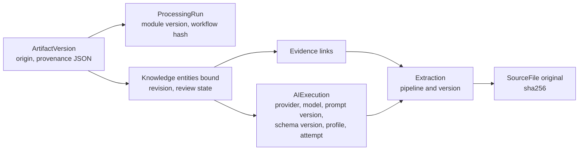

# Provenance

| Field | Value |
|---|---|
| Status | Accepted |
| Spec class | Implementation-ready |
| Version | 1.0.0 |
| Last Updated | 2026-09-28 |
| Owner | Knowledge + Artifacts + AI domains |
| Blueprint | BP §11.2, §16.1 ("Model, Prompt, and Schema versions are stored in Artifact provenance"), §16.2, §17 |

## Provenance Chain

## Recorded Fields

| Record | Provenance fields |
|---|---|
| ArtifactVersion | `origin`, `created_by`, `parent_version_id`, `processing_run_id`, `provenance{ module_key, module_version, artifact_schema_ref, prompt_versions[], model_keys[], profile_keys[], knowledge_revision_ids_hash, template_version_id? }` |
| Knowledge entity | `origin`, `processing_run_id`, `ai_execution_id`, `revision`, reviewer |
| AIExecution | provider, model, model version, prompt version, output schema ref, module version, profile, routing decision, attempt, fallback chain |
| Extraction | pipeline key/version, AIExecution IDs |
| Export | artifact version, template version, brand kit version, renderer version |

## Uses

AI transparency (AI vs human sections), audit, reproducing issues, evaluation of production regressions, model change impact analysis, legal defensibility of approved documents.
