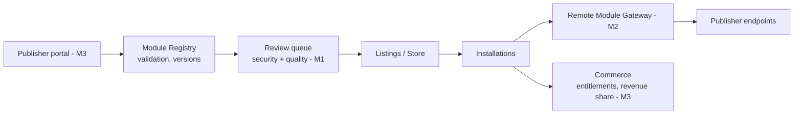

# Marketplace Architecture

| Field | Value |
|---|---|
| Status | Accepted |
| Spec class | Baseline (M0 implemented; M1+ Future) |
| Version | 1.0.0 |
| Last Updated | 2026-09-28 |
| Owner | Founder + Module Platform |
| Blueprint | BP §23, §23.1, [BDR-004](../governance/bdr/BDR-004-marketplace-future-revenue.md) |

## Principle

Marketplace concepts exist in the data model and contracts from day one; arbitrary third-party executable code is not enabled in v1. Publisher, Listing, Version, pricing metadata and review status are represented; the initial publisher is Clerk Official only.

## Status Separation

| Capability | Architecture-ready | v1 implemented | Future phase |
|---|---|---|---|
| Publisher entity | ✓ | ✓ (`clerk-official` only) | Partner/community publishers (M1/M3) |
| Listing with localisation, categories, pricing metadata | ✓ | ✓ | Reviews/ratings (M4) |
| Verification status | ✓ | ✓ (official = verified) | Partner verification process (M1) |
| Module ownership (publisher ↔ module) | ✓ | ✓ | Transfers |
| Version publishing pipeline | ✓ | ✓ (internal CI) | Publisher portal (M3) |
| Pricing & entitlements per module | ✓ | ✓ (add-ons/plan) | Publisher-set pricing (M3) |
| Compatibility checks | ✓ | ✓ | — |
| Trust signals | ✓ | Official badge | Security review badges (M2), quality scores (M4) |
| Review/moderation | ✓ | Internal review | Formal review queue (M1) |
| Suspension/deprecation | ✓ | ✓ | — |
| Declarative partner modules | ✓ | — | M1 |
| Remote modules | ✓ (contract reserved) | — | M2 |
| Revenue share & payouts | ✓ (model) | — | M3 |
| Ranking/analytics/anti-fraud | — | — | M4 |

## Components (target)

Documents: [publishers](publishers.md) · [listings](listings.md) · [review-process](review-process.md) · [trust-and-verification](trust-and-verification.md) · [third-party-modules](third-party-modules.md) · [remote-modules](remote-modules.md) · [module-sandbox](module-sandbox.md) · [revenue-share](revenue-share.md) · [marketplace-roadmap](marketplace-roadmap.md)
