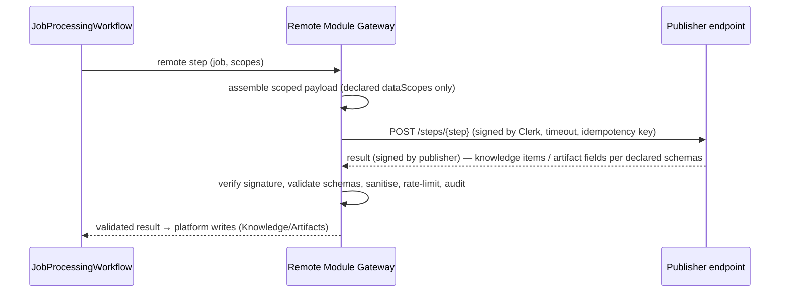

# Remote Modules

| Field | Value |
|---|---|
| Status | Proposed |
| Spec class | Future (M2) — contract reserved |
| Version | 1.0.0 |
| Last Updated | 2026-09-28 |
| Owner | Module Platform + Security |
| Blueprint | BP §4.2 (Remote: "External execution through an API contract and sandboxed permissions; no direct DB access"), §23.1 (M2) |

## Contract Sketch

## Guarantees

No DB credentials, no object-storage credentials (media via short-lived presigned GET only if scope allows), no cross-job/tenant data, timeouts and retries controlled by Clerk, every call audited as actor `remote_module`, per-tenant admin consent to scopes at install, suspension kill switch.

Manifest field `runtime.remote` is reserved in the schema; validation rejects `remote` in v1.
