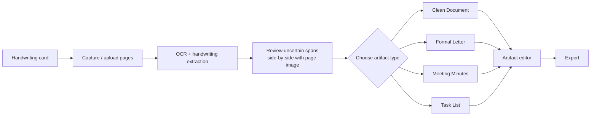

# Handwriting → Document — Product Specification

| Field | Value |
|---|---|
| Status | Accepted |
| Spec class | Implementation-ready |
| Version | 1.0.0 |
| Last Updated | 2026-09-28 |
| Owner | Product |
| Blueprint | BP §3.3, App. A, App. D |

## Goal (BP §3.3)

The user uploads one or more photos/scans of handwritten notes. Clerk extracts text and structure, highlights low-confidence spans for review, and proposes multiple possible artifacts. A single Source can become Meeting Minutes, a Formal Letter, a Clean Document or a Task List.

## Capabilities

| Capability | v1 |
|---|---|
| Photo capture (camera with edge detection guidance), scans, PDFs, multiple pages | ✓ |
| Handwriting extraction (Persian, English, mixed; printed + handwritten mix) | ✓ |
| Structure (headings, paragraphs, lists, tables, reading order) | ✓ |
| Low-confidence areas highlighted; mandatory human confirmation of uncertain spans | ✓ |
| "No silent invention": unreadable text never becomes guessed text in an official document | ✓ |
| Outputs: Clean Document (automatic), Formal Letter, Meeting Minutes, Task List (on demand) | ✓ |
| Multiple artifacts from one job/Knowledge without re-OCR | ✓ |
| Page reordering, rotation, exclusion before submit | ✓ |
| Signature/stamp detection | Future (flagged as regions only) |

## Flow (App. A)

## Distinctive UX

Review is page-image-centric: each uncertain span shows the cropped handwriting region, alternatives, and an input; keyboard navigation between spans; "mark as illegible" is an explicit, visible choice rendered as `[illegible]` in documents.
