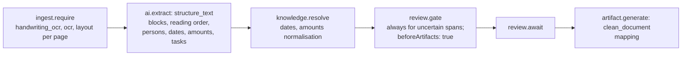

# Handwriting → Document — Workflow

| Field | Value |
|---|---|
| Status | Accepted |
| Spec class | Implementation-ready (DSL Provisional) |
| Version | 1.0.0 |
| Last Updated | 2026-09-28 |
| Owner | Module Platform + AI Engineer |
| Blueprint | BP §3.3, App. A (Handwriting Flow) |

## Processing DAG (`handwriting-processing`)

`requireReviewBeforeArtifact: true` — the clean document is generated after uncertain spans are resolved, so the first artifact version contains no guessed text.

## Additional Artifacts (`handwriting-additional-artifact`)

User chooses Formal Letter / Meeting Minutes / Task List → `POST /v1/jobs/{id}/artifacts` → run with `ai.generate` (`compose_artifact`) or mapping → new Artifact in the same Job. Several artifacts can coexist.

## Approval

`letter-approval` for formal letters (configurable; default off). Clean documents and task lists do not require approval by default.
