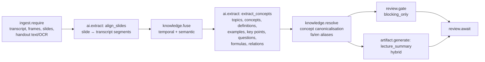

# Lecture Summary — Workflow

| Field | Value |
|---|---|
| Status | Accepted |
| Spec class | Implementation-ready (DSL Provisional) |
| Version | 1.0.0 |
| Last Updated | 2026-09-28 |
| Owner | Module Platform + AI Engineer |
| Blueprint | BP §3.4, App. A (Lecture Summary Flow) |

## Processing DAG (`lecture-processing`)

Long lectures: `extract_concepts` batches by topic segments using retrieval to keep prompts within limits ([retrieval](../../knowledge/retrieval.md)).

## Additional Artifacts

Study notes, flashcards and question sets via `lecture-additional-artifact` (`ai.generate` with `generate_study_material` task) from existing Knowledge; no re-transcription.

## Approval

None by default (education use). Organizations (training departments) may attach an approval workflow via configuration if entitled.
