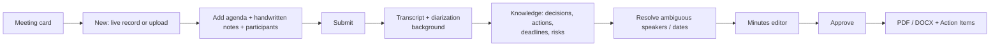

# Meeting Minutes — Product Specification

| Field | Value |
|---|---|
| Status | Accepted |
| Spec class | Implementation-ready |
| Version | 1.0.0 |
| Last Updated | 2026-09-28 |
| Owner | Product |
| Blueprint | BP §3.1, App. A |

## Goal (BP §3.1)

Transform a live meeting, audio/video file, agenda, PDF and handwritten notes into formal meeting minutes and reusable Knowledge.

## Users

Business owners/executives, project managers, administrative staff (secretaries), team leads.

## Capabilities

| Capability | v1 |
|---|---|
| Live recording (in-browser, chunked upload; processing after stop) | ✓ ([OD-036](../../governance/open-decisions.md#od-036)) |
| Uploaded audio/video | ✓ |
| Agenda (PDF/DOCX/image/text) | ✓ |
| Supporting PDFs/images | ✓ |
| Handwritten notes (photos/scans) | ✓ |
| Manual text notes | ✓ |
| Speaker diarization + attribution to participants | ✓ (ambiguity → review) |
| Participants list (from job input, calendar-free) | ✓ |
| Decisions, Proposals, Discussions, Unresolved topics | ✓ |
| Actions with Owners and Deadlines | ✓ |
| Risks, Open questions | ✓ |
| Evidence + confidence for every key fact | ✓ |
| Transcript (secondary output) | ✓ (permission-gated) |
| Formal minutes artifact with org template + numbering | ✓ |
| Task list artifact | ✓ |
| Executive summary | ✓ (on demand) |
| Follow-up message artifact | ✓ (on demand; not sent by Clerk) |
| Human review + approval | ✓ |
| Real-time captions during meeting | ✗ (Future) |
| Calendar integration / auto-join bots | ✗ (Future connectors) |

## Distinctions (must be modelled explicitly)

| Type | Definition | Example | Entity |
|---|---|---|---|
| **Decision** | A resolution the meeting agreed on (explicit agreement, authority confirmation, or recorded vote) | "Approved: the budget increase to X." | `meeting.decision` (status `decided`) |
| **Proposal** | A suggestion not (yet) agreed | "I suggest we move the deadline." with no agreement | `meeting.proposal` |
| **Discussion** | A topic discussed without a resolution requirement | Status update on procurement | `meeting.discussion_point` |
| **Unresolved topic** | A topic requiring a decision that was not reached | "We need to decide the vendor next week." | `meeting.unresolved_topic` |
| **Action item** | A commitment to do something, ideally with owner and deadline | "Reza will send revised drawings by 12 Mehr." | `meeting.action` |

Annotation guidelines include linguistic cues for Persian (for example «مصوب شد», «قرار شد», «پیشنهاد می‌شود», «بررسی شود») and rules for conditional decisions.

## Primary Flow (App. A)

## Non-Goals

Sending emails to participants (follow-up is an artifact the user copies/exports), task-management features beyond Action Items, CRM logging.

## Success Metrics

Time-to-Artifact (p50 < 15 min for a 60-min meeting — provisional), Artifact Acceptance Rate, Human Correction Rate for actions, Evidence Coverage ≥ 90%.
